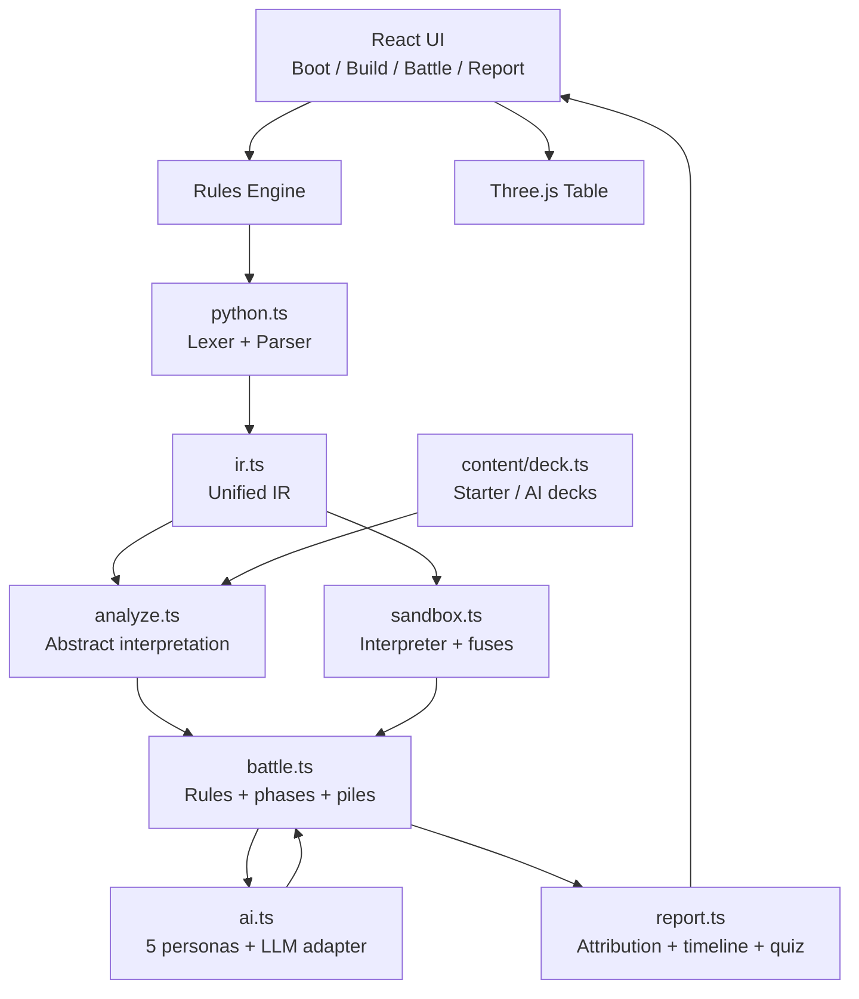

<a id="top"></a>

<div align="center">


# CODE THE BATTLE

### 断链协议 · Protocol Breach

**一个把「写代码」重新变成战斗的回合制卡牌编程游戏。**

> **“vibe code太久，忘了代码怎么写，来玩code the battle，在回合制卡牌对战中证明你的代码能比ai写得好！”**

*“Vibe-coded too long and forgot how to code? Play Code the Battle and prove your code beats the AI in a turn-based card duel.”*

[](https://warpshlczy.github.io/Code-the-Battle/)
[](https://github.com/Warpshlczy/Code-the-Battle/actions/workflows/deploy.yml)
[](https://react.dev/)
[](https://www.typescriptlang.org/)
[](https://vite.dev/)
[](https://threejs.org/)
[](https://vitest.dev/)

`NO BACKEND` · `NO ACCOUNT` · `NO AI CODE COMPLETION` · `JUST YOUR CODE`

</div>

---

## 目录

- [01 · 这是什么](#what)
- [02 · 为什么是 Code the Battle](#why)
- [03 · 功能地图](#features)
- [04 · 在线试玩](#live)
- [05 · 本地启动](#start)
- [06 · 五分钟上手](#quickstart)
- [07 · 规则手册](#rules)
- [08 · 写卡指南](#cards)
- [09 · 回合脚本指南](#scripts)
- [10 · API 完全手册](#api)
- [11 · 两套预算：效果上限与算力](#economy)
- [12 · AI 对手](#ai)
- [13 · 战后复盘](#report)
- [14 · 中英双语与默认英文](#i18n)
- [15 · 技术架构](#architecture)
- [16 · 项目结构](#structure)
- [17 · 开发、测试与构建](#dev)
- [18 · GitHub Pages 部署](#deploy)
- [19 · README 是怎么做出来的](#readme)
- [20 · 设计取舍与边界](#design)
- [21 · FAQ](#faq)
- [22 · English quick start](#english)
- [23 · 贡献与致谢](#credits)

---

<a id="what"></a>
## 01 · 这是什么

**Code the Battle** 是一个完全运行在浏览器里的单机回合制卡牌编程游戏。

你在构筑阶段亲手写 **5–10 张卡牌**，在对局阶段亲手写 **每一回合的战术脚本**。规则引擎负责静态分析、沙盒执行、伤害结算和日志记录。战后再把整局拆成逐行归因、牌堆回放和读码审讯。

对面坐着 **SENTINEL-07**，一台人形支配体。它和你使用同一套卡牌、能量、牌堆与算力规则；它看不到你的代码，也看不到你的手牌，更不会提前告诉你下一步想做什么。

> 这不是“让 AI 帮你写牌”的游戏。
> 恰恰相反：**AI 只是对手，代码必须由你写。**

<div align="center">

| 项目 | 规模 |
| --- | --- |
| 应用代码 | ~13,900 行 TypeScript / TSX |
| 测试 | 8 个测试文件，53 项测试 |
| 规则引擎 | 词法 → 语法 → IR → 抽象解释 → 沙盒执行 |
| 对局常量 | 双方 100 HP · 每回合 5 能量 · 起手 5 张 · 30 回合上限 |
| 牌组 | 5–10 张，最多 10 张 |
| API | 29 个核心 API + 只读快照访问 |
| AI 人格 | 5 种固定战斗风格 + 可选外接 LLM 提议 |
| 复盘 | 行级归因 · 牌堆时间轴 · 读码审讯 · 重放校验 |
| 语言 | 默认 English，右上角随时切换 中文 / EN |
| 部署 | GitHub Actions → GitHub Pages，纯静态站点 |

</div>

### 一句话卖点

> **你不需要先成为“会写代码的人”。你只需要写出一张能打的牌，然后证明它比 AI 更懂战场。**

---

<a id="why"></a>
## 02 · 为什么是 Code the Battle

### 2.1 那个所有人都经历过的瞬间

你让 AI 写了一个功能。它跑起来了。

你让它再改改。它也跑起来了。

三天后，你打开文件，发现：

- 变量名像密码；
- 注释在解释上一版逻辑；
- 你知道它“能跑”，但说不清它**为什么能跑**；
- 你曾经会的语言，变成了一种“只在 review 时见过”的外语。

于是就有了这个游戏。

**“vibe code太久，忘了代码怎么写，来玩code the battle，在回合制卡牌对战中证明你的代码能比ai写得好！”**

这不是一句口号，而是整套设计的起点：

| 普通卡牌游戏 | Code the Battle |
| --- | --- |
| 点一下按钮，卡牌自动结算 | 卡牌效果是你写的一个 `effect(self, ctx)` |
| 战术靠手速和运气 | 战术靠手牌顺序、资源和脚本 |
| 卡牌数值由设计师平衡 | 卡牌强度由费用上限和效果预算裁决 |
| 输了看结算画面 | 输了看逐行归因，知道哪一行害了你 |
| AI 帮你出牌 / 自动构筑 | AI 只做对手，连你的代码都读不到 |
| 复盘是统计图表 | 复盘是“读码审讯”，答错会指出证据 |

### 2.2 三个承诺

1. **代码真的在运行。** 不是动画假装，不是预设脚本。你的 `deal_damage` 会经过 IR、抽象解释、沙盒和战斗引擎，最后写进事件日志。
2. **AI 真的没有偷看。** 对手只拿公开场面和自己的手牌。卡名、描述、你的手牌、你的抽牌顺序、你的代码，全部不进提示词。
3. **复盘真的能学到东西。** 每一行 API 调用都会记录来源、行号、算力、伤害、格挡、治疗和牌堆操作。战斗结束后，你能看到“哪一行代码造成了什么”。

### 2.3 适合谁

- 想重新找回“手写逻辑”快感的开发者；
- 喜欢 Slay the Spire / 炉石 / 万智牌，但想要更深一层程序表达的玩家；
- 正在学编程，想把变量、循环、条件、函数放进一个**有即时反馈**的场景里的人；
- 被 AI 生成代码包围，想确认自己还能从零写出一个能跑的系统的人；
- 喜欢赛博美术、全息牌桌、电子终端和故障美学的人。

---

<a id="features"></a>
## 03 · 功能地图

### 3.1 构筑期

- **手写卡牌类**：固定 `name / cost / type / target` 字段，只开放 `effect(self, ctx)`。
- **实时静态分析**：行数、复杂度、变量数、API 调用、牌堆操作、效果上限 `P`、算力、诊断信息。
- **费用上限裁决**：费用直接决定效果上限，超过就编译失败。
- **寄存器编辑**：最多 3 个，支持 `int / bool / enum`，可声明范围。
- **种子与对手风格**：同一个种子可以复现同一局；战前只披露战斗风格。
- **卡面画笔**：512×360 画布，笔触大小、调色板、自定义颜色、橡皮、撤销、重做、清空。
- **卡面预览**：画作进入 DOM 卡面、悬浮提示、弃牌预览和 3D 手牌。
- **牌组校验**：5–10 张；展示总费用、每张卡的效果上限和诊断。
- **外接战术（可选）**：填写兼容 `chat/completions` 的端点、模型和 Key；Key 只留在页面内存。

### 3.2 对局期

- **底部电子终端**：写脚本 → 确认命令 → 回战场 → 执行终端命令；可以反复执行多个指令块。
- **最左出牌**：`ctx.playcard()` 永远打出最左边那张牌，手牌顺序就是战术。
- **手牌调度**：`swap` / `move_card` 调整队列；`pile_costs` 读取费用。
- **能量中断**：能量不够时命令立即中断，弹窗说明需要多少、当前多少，并高亮“跳过回合”。
- **全息 Three.js 牌桌**：双方抽牌堆 / 手牌 / 弃牌堆常驻显示；牌堆托盘、发光边、张数标签。
- **出牌动画**：卡牌飞向展示区、翻面、高亮，再落弃牌堆；剩余手牌滑到新位置。
- **格挡表现**：48px 大号计数器，获得时弹跳发光，被打破时碎裂抖动并飞散护盾碎片。
- **演出控制**：慢速 / ×2 / ×3 / 跳过；`prefers-reduced-motion` 直接落最终状态。
- **随时查看牌库**：双方构筑完整卡牌列表；敌方牌库单独放在对手情报里。

### 3.3 战后复盘

- **代码账本**：来源、行号、API、算力、伤害、格挡、治疗、牌堆操作。
- **牌堆回放**：抽牌、弃牌、洗牌、寄存器写入、熔断、AI 动作的时间轴。
- **读码审讯**：从本局日志生成的单选题；答错会给出证据和解释。
- **对手档案**：人格、提议次数、回退次数、样本动作和审计记录。
- **重放校验**：把事件重放成公共状态，校验哈希与资源状态。
- **导出日志**：JSON 包含种子、结果、回合、牌组预算、AI 审计和全部事件。

### 3.4 表现与体验

- 动态标题页：扫描线、暗角、全息 SENTINEL 画像、漂浮卡牌数据。
- 程序化 SVG 美术：竞技场、玩家、敌人、攻击/技能卡面插画。
- 运行时 Canvas 纹理：牌桌、卡背、卡面、自绘卡画。
- 响应式相机：竖屏自动拉远，手牌扇形布局保持最左牌清晰。
- 手牌 mesh 增量对账：出牌、抽牌、弃牌只移动必要的 mesh。
- 弃牌堆点击展开：可读行、Esc 收起；敌方弃牌可单独靠近浏览。
- 语言按钮固定在右上角，所有屏幕与弹窗都可见。

---

<a id="live"></a>
## 04 · 在线试玩

**Live demo：** https://warpshlczy.github.io/Code-the-Battle/

- 无需登录，无需下载，纯静态部署。
- 推荐使用最新版 Chrome / Edge / Firefox / Safari。
- 需要 WebGL 才能看到 Three.js 牌桌；不支持时仍会显示“3D 场景不可用”的提示。
- 游戏状态不写入服务器；语言选择保存在浏览器 `localStorage`。
- 外接 LLM 的 Key 只保存在页面内存，刷新即消失。

第一次玩的建议：

1. 先点 **“查看战斗规则”**，看 30 秒规则简报。
2. 直接使用默认英文牌组进入构筑，先不要改代码。
3. 在对局终端点 **“示例”**，确认命令，再执行一次。
4. 试一次 **“手写排序”**，感受 `pile_costs + swap + playcard` 的差别。
5. 打完后去复盘页看 **代码账本** 和 **读码审讯**。

---

<a id="start"></a>
## 05 · 本地启动

### 5.1 环境要求

- Node.js 20+（建议 22 LTS）
- npm 10+
- 现代浏览器（WebGL 2 / Canvas 2D / ES2022）

### 5.2 安装与运行

```bash
git clone https://github.com/Warpshlczy/Code-the-Battle.git
cd Code-the-Battle
npm install
npm run dev
```

打开 Vite 输出的地址即可。默认开发服务器绑定 `127.0.0.1`：

```bash
npm run dev -- --host 0.0.0.0 --port 5173
```

### 5.3 构建与预览

```bash
npm run build     # tsc -b && vite build
npm run preview   # 预览 dist/
```

`vite.config.ts` 使用 `base: './'`，因此构建产物可以直接放在任意子路径下，适合 GitHub Pages 项目站点。

### 5.4 测试

```bash
npm test          # vitest run
npm run test:watch
```

当前基线：**8 个测试文件、53 项测试全部通过**。覆盖规则、算力、AI、表现、平衡、重放和冒烟流程。

### 5.5 脚本一览

| 命令 | 作用 |
| --- | --- |
| `npm run dev` | 启动 Vite 开发服务器 |
| `npm run build` | TypeScript 项目构建 + Vite 生产构建，产物到 `dist/` |
| `npm run preview` | 本地预览生产构建 |
| `npm test` | 运行一次 Vitest |
| `npm run test:watch` | 监听模式运行 Vitest |

---

<a id="quickstart"></a>
## 06 · 五分钟上手

### 第 1 步：标题页

- 右上角 **EN / 中文** 按钮可以随时切换语言，默认英文。
- 点 **ENTER THE BUILD** 进入构筑。
- 点 **View combat rules** 打开规则简报。

### 第 2 步：构筑

1. 左侧是卡牌编辑器；默认牌组有 5–10 张示例卡。
2. 右侧可以编辑寄存器、种子、对手风格和外接战术。
3. 每张卡会显示效果上限 `P`、算力、诊断和当前费用。
4. 点卡牌的“卡面”面板，可以用画笔自己画一张卡面。
5. 所有卡牌通过检查、牌组 5–10 张、寄存器合法后，才能开始对局。

### 第 3 步：对局

1. 底部终端默认在 **指令** 页。
2. 写脚本，或点 **示例 / 手写排序 / 上一回合** 快速载入。
3. 点 **确认命令**；命令会被按最坏情况锁定。
4. 回到战场，点 **执行终端命令**。
5. 可以继续写下一段并再次执行；点 **跳过回合** 才结束自己的回合。
6. 能量不足时命令会中断，弹窗会说明是哪张牌、需要多少、当前多少。

> **关键区别：**“确认命令”只是编译/锁定，不会立即结算；“执行终端命令”才真正跑脚本。

### 第 4 步：复盘

战斗结束后自动进入复盘：

- **代码账本**：哪一行、哪个 API、多少算力、造成多少伤害；
- **牌堆回放**：这一局的手牌、抽牌、弃牌、洗牌和寄存器变化；
- **读码审讯**：回答关于本局代码行为的问题；
- **对手档案**：查看 SENTINEL 的人格、提议和回退；
- **重放校验**：验证事件重放后的状态哈希。

### 界面语言

- 默认英文，首次打开是 English。
- 右上角 `EN / 中文` 随时切换，不需要刷新。
- 切换语言会本地化未修改的示例卡牌和默认寄存器；你自己写的卡牌源码不会被改写。
- 切换只影响显示，不改变对局结果、事件日志或重放签名。

---

<a id="rules"></a>
## 07 · 规则手册

### 7.1 开局

| 规则 | 数值 |
| --- | --- |
| 玩家生命 | 100 |
| SENTINEL 生命 | 100 |
| 每回合能量 | 5 |
| 起手 | 5 张 |
| 每回合抽至 | 5 张 |
| 手牌上限 | 10 |
| 牌组 | 5–10 张 |
| 回合上限 | 30 |
| 玩家牌组费用展示 | 所有卡牌费用之和 |
| 对手牌组 | 与玩家同一套牌、能量和牌堆规则 |

### 7.2 一个回合的固定流程

1. **回合开始**
   - 自己上一回合留下的格挡清零（记日志、播放护罩消散）。
   - 能量重置为 5。
   - 抽牌至 5 张；抽牌堆为空时自动把弃牌堆洗回。
2. **战术段**
   - 你在终端写脚本。
   - 可以调用出牌、牌堆、只读查询、寄存器写入和资源 API。
   - 所有脚本调用共享 **14 点算力**。
3. **出牌**
   - `ctx.playcard()` 永远只打手牌最左第 1 张。
   - 只有能量足够才结算。
   - 卡牌效果由能量付费，**不重复扣脚本算力**。
4. **寄存器**
   - `set_global()` 立即写入并校验范围；不做回合末批量提交。
5. **回合结束**
   - 所有剩余手牌进入弃牌堆（记日志、播放飞牌动画）。
6. **敌方回合**
   - SENTINEL 使用同一套能量、牌堆和算力规则。
   - 它只看公开场面和自己的手牌；结束后同样弃光手牌。
7. **兜底**
   - 任意一方生命归零立即结束。
   - 30 回合后按双方剩余生命比例判定。

### 7.3 伤害、格挡与治疗

- **格挡没有上限**，但**只持续一回合**：自己的下个回合开始时清零。
- 伤害先扣格挡，再扣生命。
- 治疗不能超过生命上限。
- 自伤 `ctx.deal_damage("self", n)` 会按负面效果抵扣一部分净效果。
- 卡牌效果、脚本、AI 使用同一套结算逻辑。

### 7.4 牌组

- 必须 **5–10 张**，最多 10 张。
- 没有牌组预算，没有同名数量限制。
- 同名牌可以重复；卡面会按 uid 区分，重复同名不会串脸。
- 牌组里的顺序不直接决定起手；抽牌由固定种子 RNG 决定。
- 构筑界面会展示总费用和每张卡的效果上限。

### 7.5 手牌与牌堆

- 双方各有 **抽牌堆 / 手牌 / 弃牌堆**。
- 我方手牌可见，敌方手牌始终是卡背。
- 抽牌堆显示卡背与张数；弃牌堆公开牌面。
- 手牌最左是下一个出牌位；`swap` / `move_card` 可以改变顺序。
- 回合结束时整手牌进入弃牌堆，不会保留到下一回合。

### 7.6 寄存器

- 最多 **3 个**。
- 类型：`int` / `bool` / `enum`。
- `int` 必须声明 `min / max`，跨度不超过 1000。
- `enum` 支持 1–8 个值。
- `set_global()` 只能在回合脚本中使用，立即生效。
- `get_global()` 卡牌效果和脚本都能读取。
- 寄存器不跨局保留。

默认英文寄存器：

```python
combo : int  = 0      # 0..20
guard : bool = false
mode  : enum = "idle" # idle / assault / hold
```

默认中文寄存器仍保留在源码中，供测试与中文界面使用：

```python
combo : int  = 0      # 0..20
guard : bool = false
mode  : enum = "默认" # 默认 / 强攻 / 蛰伏
```

### 7.7 胜负

- 敌方生命归零 → **协议突破 / victory**。
- 我方生命归零 → **链路中断 / defeat**。
- 30 回合仍未分胜负 → 按剩余生命比例判定。
- 退出对局不会生成复盘记录。

### 7.8 确定性

- 同一牌组 + 同一寄存器 + 同一脚本 + 同一种子 + 录制下来的 AI 动作 = 可重放。
- 游戏使用固定种子 RNG；AI 的随机性也走同一 RNG。
- 外接 LLM 对手的提议会被记录；重放使用录制的动作，不重新请求模型。

### 7.9 硬限制

| 限制 | 卡牌 `effect` | 回合脚本 |
| --- | --- | --- |
| 最大行数 | 20 | 20 |
| 最大复杂度 | 80 | 60 |
| 辅助函数 | 最多 3 个 | 最多 3 个 |
| 每个辅助函数 | 30 行 / 120 复杂度 | 30 行 / 120 复杂度 |
| 单行字符 | 200 | 200 |
| 最大变量 | 10 | 10 |
| 最大列表 | 8 | 8 |
| 最大嵌套 | 4 | 4 |
| 最大循环深度 | 2 | 2 |
| 单层循环上界 | 10 | 10 |
| 总迭代上限 | 96 | 120 |
| 列表写入 | 64 | 64 |
| 调用深度 | 3 | 3 |
| 执行时间熔断 | — | 140ms |

编辑器在写超限时会**硬停**，粘贴也无法绕过。循环上界说不清、递归、`eval`、文件、网络、反射都不会通过编译。

---

<a id="cards"></a>
## 08 · 写卡指南

### 8.1 最小卡牌

```python
class DirectStrike(Card):
    name = "Direct Strike"
    cost = 1
    type = "attack"
    target = "enemy"

    def effect(self, ctx):
        ctx.deal_damage("enemy", 7)  // Deal 7 damage
```

这张卡：

- 费用 1；
- 效果上限 2.4；
- 造成 7 点伤害（在脚本预算体系里是另一套账）；
- 行尾 `//` 注释会成为卡面说明；
- 进入 3D 牌桌时会使用玩家选择的卡面。

### 8.2 固定字段

| 字段 | 允许值 | 说明 |
| --- | --- | --- |
| `name` | 字符串 | 卡名，显示在卡面与日志 |
| `cost` | 整数 | 决定效果上限 `P` |
| `type` | `attack` / `skill` | 只允许两种 |
| `target` | `enemy` / `self` / `none` | 只允许三种 |
| `effect(self, ctx)` | 函数 | 唯一开放的效果入口 |

不支持状态系统、稀有度、卡牌生成/删除 API、任意代码执行、文件/网络/反射/`eval`、直接修改牌堆内部数组、跨局寄存器或自定义结算顺序。

### 8.3 费用决定效果上限

| 费用 | 效果上限 `P` |
| --- | --- |
| 0 | 1.5 |
| 1 | 2.4 |
| 2 | 3.2 |
| 3 | 4.2 |
| 4 | 5.5 |
| 5 及以上 | 6.4 |

规则：

- 超过上限直接编译失败，并指出超出的行。
- 0 费卡禁止 `gain_energy()`。
- 负面效果可以抵扣一部分净效果：
  - `deal_damage("self", n)`；
  - `discard(n)`；
  - `lose_energy(n)`。
- 没有单次伤害/治疗/格挡/抽牌/回能上限；真正的上限来自费用、效果预算和算力。
- 表达式本身也计费：运算符、变量、嵌套越多，构筑期成本越高，防止 `((2+3)*5)` 这种写法隐藏强度。

### 8.4 卡面说明

`def effect` 里的 `//` 注释会成为卡面描述，多行用 ` · ` 连接：

```python
def effect(self, ctx):
    ctx.deal_damage("enemy", 7)  // Deal 7 damage
    ctx.gain_block(2)            // Gain 2 Block this turn
```

### 8.5 卡面画笔

构筑期“卡面”面板提供：

- 512×360 画布；
- 笔触大小 1–12；
- 8 个预设颜色 + 自定义颜色；
- 橡皮、撤销、重做、清空；
- 边框色、底色和标记作为底层外观；
- 画作会进入 DOM 预览、悬浮提示、弃牌预览与 3D 手牌。

画作只保存在本次构筑会话，不写入后端，也不跨局持久化。

### 8.6 示例：自伤换伤害

```python
class OverloadSlash(Card):
    name = "Overload Slash"
    cost = 2
    type = "attack"
    target = "enemy"

    def effect(self, ctx):
        ctx.deal_damage("enemy", 8)  // Deal 8 damage
        ctx.deal_damage("self", 2)   // Take 2 self-damage; it discounts the effect
```

注意：自伤不是“免费加数值”。它会进入负面效果抵扣，降低净效果，也会在卡面统计和效果上限里体现。

### 8.7 示例：0 费卡

```python
class GlimmerPulse(Card):
    name = "Glimmer Pulse"
    cost = 0
    type = "attack"
    target = "enemy"

    def effect(self, ctx):
        ctx.deal_damage("enemy", 2)  // 0 cost: effect cap is 1.5
```

0 费卡的上限是 1.5，不能靠 `gain_energy()` 变成“免费引擎”。

### 8.8 常见编译失败

| 现象 | 原因 |
| --- | --- |
| 效果超出费用上限 | 减少数值、拆成多张卡或加负面效果 |
| 0 费卡使用 `gain_energy` | 规则禁止 |
| 循环上界无法证明 | 用固定 `range()` 或直接写语句 |
| 递归 / `eval` / 文件 / 网络 | 沙盒白名单拒绝 |
| 行数或复杂度超限 | 编辑器硬停，拆函数或简化逻辑 |
| `set_global` 名字不是字面量 | 寄存器名必须写成字符串常量 |
| 寄存器越界 | 检查声明范围与实际写入值 |

---

<a id="scripts"></a>
## 09 · 回合脚本指南

### 9.1 脚本不是卡牌类

回合脚本直接写语句，不需要 `class`：

```python
ctx.playcard()
ctx.playcard()
ctx.playcard()
ctx.playcard()
ctx.set_global("combo", min(ctx.get_global("combo") + 1, 20))
```

### 9.2 执行模型

- 每回合脚本共享 **14 点算力**。
- 卡牌效果由能量付费，不重复扣算力。
- 点“确认命令”时，引擎按**最坏情况**估算并锁定。
- 点“执行终端命令”时才真正运行。
- 可以连续执行多个指令块，花费累计。
- 运行时还有迭代、时间、列表写入和字符串长度的熔断。
- 能量不足时中断会保留已经执行的动作；修正后可以重新提交。

### 9.3 手牌顺序就是战术

`ctx.playcard()` 永远打最左牌。所以：

- 想把大伤害先打出去 → 用 `swap` / `move_card` 调整顺序；
- 想先架格挡 → 把格挡牌移到最左；
- 想先抽牌 → 先调度抽牌卡；
- 想保留某张牌 → 不要把它放在最左。

示例：一轮冒泡排序

```python
costs = ctx.pile_costs("hand")
for i in range(1, 4):
    if costs[i] > costs[i - 1]:
        ctx.swap("hand", i - 1, i)
ctx.playcard()
ctx.playcard()
ctx.playcard()
```

这段脚本做三件事：

1. 读取手牌费用；
2. 做一轮局部排序，把更贵的牌往左推；
3. 打出三张，优先让高费牌落地。

### 9.4 脚本与卡牌的区别

| 维度 | 卡牌效果 | 回合脚本 |
| --- | --- | --- |
| 入口 | `effect(self, ctx)` | 直接写语句 |
| 付费 | 能量 | 算力 |
| 预算 | 费用对应的效果上限 `P` | 每回合 14 点算力 |
| 运行时机 | 打出时 | 点击“执行终端命令”时 |
| 可以 `playcard` | 否 | 是 |
| 可以 `set_global` | 否 | 是 |
| 可以读取全局 | 是 | 是 |
| 是否参与重放 | 是 | 是 |

### 9.5 被锁死的反例

```python
ctx.deal_damage("enemy", 10 * ctx.getTurn())
```

这不是“聪明”，而是把最坏情况推到很高。抽象解释会按上界估算，一旦超过 14 点算力，确认命令就会失败。

正确思路：

- 用读取和调度降低不确定性；
- 用固定小数值多次结算；
- 用寄存器保存状态，而不是每次重新读一大堆数据；
- 用循环压缩重复语句，但记住循环体成本会乘以迭代上界。

### 9.6 寄存器脚本

```python
mode = ctx.get_global("mode")
if mode == "assault":
    ctx.playcard()
    ctx.playcard()
else:
    ctx.gain_block(3)
ctx.set_global("combo", min(ctx.get_global("combo") + 1, 20))
```

`set_global` 立即生效；同一段脚本后续读取会拿到新值。

---

<a id="api"></a>
## 10 · API 完全手册

### 10.0 约定

- 所有调用都挂在 `ctx` 上。
- `scope`：
  - **both** = 卡牌效果和回合脚本都能用；
  - **script** = 只能在回合脚本里用。
- 表中的价格是**脚本算力价格**，不是构筑期效果上限 `P`。
- 实际算力还会叠加表达式、循环、条件和嵌套成本，所以 UI 显示的总价可能高于 API 基础价。
- 牌堆参数只能是 `"draw"` / `"hand"` / `"discard"`。
- 伤害目标只能是 `"enemy"` / `"self"`。

### 10.1 出牌与调度

| 签名 | 作用域 | 返回 | 基础算力 | 说明 |
| --- | --- | --- | --- | --- |
| `ctx.playcard()` | script | bool | 0.8 | 打出最左手牌；只花能量，不读取手牌内容 |
| `ctx.swap(pile, i, j)` | both | none | 0.3 | 交换同一牌堆里的两张牌 |
| `ctx.move_card(from, fi, to, ti)` | both | none | 0.5 | 把一张牌从任意牌堆移到另一个牌堆的指定位置 |

示例：

```python
ctx.swap("hand", 0, 1)
ctx.move_card("draw", 0, "hand", 0)
ctx.playcard()
```

### 10.2 抽牌、弃牌与牌堆

| 签名 | 作用域 | 返回 | 算力公式 | 说明 |
| --- | --- | --- | --- | --- |
| `ctx.draw(n)` | both | int | `1.5 + 0.9n + 0.04n²` | 抽 n 张；抽牌堆空时自动洗回弃牌堆 |
| `ctx.discard(n)` | both | int | `1.2 + 0.7n` | 弃掉最左边 n 张手牌；负面效果 |
| `ctx.shuffle()` | both | none | `2.5` | 按本局种子重洗抽牌堆 |
| `ctx.reshuffle()` | both | int | `3` | 把弃牌堆洗回抽牌堆，满时停止 |
| `ctx.pile_costs(pile)` | both | intlist | `0.3 + 0.08n` | 读取一个牌堆里每张牌的费用 |
| `ctx.hand_size()` | both | int | `0.1 + 0.06n` | 读取手牌数量 |
| `ctx.draw_size()` | both | int | `0.1 + 0.06n` | 读取抽牌堆数量 |
| `ctx.discard_size()` | both | int | `0.1 + 0.06n` | 读取弃牌堆数量 |
| `ctx.getHand()` | both | cardlist | `0.4 + 0.12n` | 手牌只读快照 |
| `ctx.getDraw()` | both | cardlist | `0.4 + 0.12n` | 抽牌堆只读快照 |
| `ctx.getDiscard()` | both | cardlist | `0.4 + 0.12n` | 弃牌堆只读快照 |

说明：

- `getHand / getDraw / getDiscard` 返回的卡牌快照包含名称、费用、类型、目标。
- 不能直接访问 `ctx.hand` / `ctx.draw_pile` / `ctx.discard_pile` 的内部数组。
- `discard` 是负面效果，可用于抵扣部分净效果。

### 10.3 战斗与资源

| 签名 | 作用域 | 返回 | 算力公式 | 说明 |
| --- | --- | --- | --- | --- |
| `ctx.deal_damage(target, a)` | both | int | `4 + 1.2a + 0.12a²` | 伤害；先扣格挡再扣生命 |
| `ctx.gain_block(a)` | both | none | `5 + 1.5a + 0.25a²` | 获得格挡，持续到自己的下个回合开始 |
| `ctx.heal(a)` | both | none | `4 + 2a + 0.2a²` | 回复生命，不超过上限 |
| `ctx.gain_energy(a)` | both | none | `14 + 8a` | 立即获得能量；很贵，0 费卡禁止 |
| `ctx.lose_energy(a)` | both | none | `1 + 0.8a` | 失去能量，不低于 0；负面效果 |
| `ctx.random_int(min, max)` | both | int | `2 + 0.4×span` | 固定种子随机整数，可重放 |
| `ctx.log(message)` | both | none | `0.2` | 写入战斗记录，供逐行复盘 |

`span = max - min`，且 `min >= 0`。

### 10.4 只读查询

| 签名 | 作用域 | 返回 | 算力公式 | 说明 |
| --- | --- | --- | --- | --- |
| `ctx.getTurn()` | both | int | `0.1 + 0.03n` | 当前回合数 |
| `ctx.getEnergy()` | both | int | `0.1 + 0.04n` | 当前能量 |
| `ctx.getBlock()` | both | int | `0.1 + 0.02n` | 当前格挡 |
| `ctx.getMaxEnergy()` | both | int | `0.1 + 0.04n` | 每回合能量上限 |
| `ctx.getHandLimit()` | both | int | `0.1 + 0.06n` | 手牌上限 |
| `ctx.getDrawLimit()` | both | int | `0.1 + 0.06n` | 抽牌堆上限 |
| `ctx.enemy.hp()` | both | int | `0.1 + 0.015×HP` | 对手当前生命 |
| `ctx.enemy.block()` | both | int | `0.1 + 0.02×Block` | 对手当前格挡 |
| `ctx.get_global(name)` | both | str / int / bool | `0.15 + 0.05n` | 读取寄存器 |

### 10.5 寄存器、随机与日志

| 签名 | 作用域 | 返回 | 算力 | 说明 |
| --- | --- | --- | --- | --- |
| `ctx.set_global(name, value)` | script | none | `0.6` | 写入寄存器；名字必须是字符串字面量 |
| `ctx.get_global(name)` | both | 寄存器类型 | `0.15 + 0.05n` | 读取寄存器 |
| `ctx.random_int(min, max)` | both | int | `2 + 0.4×span` | 固定种子随机 |
| `ctx.log(message)` | both | none | `0.2` | 玩家日志 |

### 10.6 快照字段

| 表达式 | 作用域 | 返回 | 说明 |
| --- | --- | --- | --- |
| `ctx.turn.played_count` | both | int | 本回合已出牌次数 |
| `ctx.turn.discarded_count` | both | int | 本回合已弃牌次数 |
| `card.name` | both | str | 卡牌快照名称 |
| `card.cost` | both | int | 卡牌快照费用 |
| `card.type` | both | str | `attack` / `skill` |
| `card.target` | both | str | `enemy` / `self` / `none` |

`ctx.turn` 字段读取按固定读取计价；`card.*` 只存在于 `getHand / getDraw / getDiscard` 返回的列表元素里。

### 10.7 不建议的写法

```python
ctx.deal_damage("enemy", ctx.getTurn() * 10)
ctx.draw(8)
ctx.gain_energy(3)
```

这些写法不是不能用，而是：

- 抽象解释会按上界估算；
- 平方项会惩罚大数值；
- 一旦最坏情况超过 14 点算力，就会在“确认命令”时失败；
- 运行时还有 140ms 熔断和迭代上限。

---

<a id="economy"></a>
## 11 · 两套预算：效果上限与算力

这是本作最重要的设计：**卡牌强度与脚本强度不是一套账。**

### 11.1 构筑期：效果上限 `P`

- 只计算卡牌 `effect` 的效果上限。
- 费用决定上限。
- 展示每个 API 的“效果值”和每张卡当前 `P`。
- 超过上限 → 编译失败。
- 负面效果抵扣净效果。

### 11.2 对局期：算力 `Credits`

- 只计算回合脚本的算力。
- 每回合共享 14 点。
- 展示脚本算力、运行时算力和每条 API 的公式。
- 卡牌效果不重复扣算力，只花能量。
- 确认命令时按最坏情况锁定；运行时再次兜底。

### 11.3 为什么这样设计

| 如果只有一套预算 | 后果 |
| --- | --- |
| 只用费用限制卡牌 | 脚本可以无限调度，手牌顺序失去意义 |
| 只用算力限制脚本 | 卡牌可以无限强，费用变成装饰 |
| 两套混在一起 | 玩家无法理解“这张卡为什么强/这段脚本为什么贵” |

所以：

- **卡牌**回答“这张牌本身有多强”；
- **脚本**回答“这一回合你调度得有多复杂”；
- 两者分开，战斗才有“构筑 + 操作”两层决策。

### 11.4 算力价格的直觉

| 类型 | 价格倾向 | 原因 |
| --- | --- | --- |
| 伤害 / 格挡 / 治疗 | 中高价，平方增长 | 数值越大，越容易滚雪球 |
| 回能 | 极贵 | 能量会放大整回合输出 |
| 抽牌 / 弃牌 | 中价，按张数增长 | 牌差直接改变回合质量 |
| 调度 | 低价 | 鼓励玩家关注手牌顺序 |
| 只读 | 低价 | 信息不应该比行动更贵 |
| 日志 | 极低 | 鼓励复盘 |

---

<a id="ai"></a>
## 12 · AI 对手

### 12.1 SENTINEL-07 的五种人格

| 人格 | 英文 | 风格 | 行为倾向 |
| --- | --- | --- | --- |
| 快攻 | Aggressor | Rush / sustained pressure | 血量安全时连续进攻，不浪费能量防守 |
| 控场 | Controller | Control / slow tempo | 先架格挡再慢慢压上，逼你用资源拆防线 |
| 弃牌联动 | Discarder | Discard / queue tuning | 丢掉挡在最左的牌，让攻击接上 |
| 抽牌连击 | Combo | Draw / multi-card turns | 先补手牌与能量，再一口气连续出牌 |
| 诱饵反打 | Bait | Counterpunch / resource patience | 血线低时先守住，等你打空能量再反击 |

### 12.2 AI 能看到什么

**可以：**

- 公开场面：双方生命、格挡、牌堆张数、弃牌、回合数；
- 自己的手牌；
- 自己的能量和牌组信息；
- 公开的玩家行动结果。

**不可以：**

- 你的卡名、卡面描述；
- 你的手牌；
- 你的抽牌顺序；
- 你的代码；
- 隐藏资源或未来意图。

### 12.3 外接 LLM（可选）

- 构筑期切到“外接战术”。
- 填写兼容 `chat/completions` 的端点、模型和 Key。
- Key 只留在页面内存，不写入 localStorage 或后端。
- 浏览器直连需要端点允许 CORS。
- 任何非法、超时、超预算或解析失败都会**整份回退**到固定战术，并写入审计。
- LLM 只输出动作计划，最终仍由规则引擎校验后执行。

### 12.4 公平性

- 对手使用同一套牌、能量、牌堆和算力规则。
- 对手没有意图预告。
- 对手不能读玩家代码/手牌/抽牌顺序。
- 对手的卡名与描述不进入提示词。
- 战前只披露“战斗风格”，不披露具体手牌或计划。

---

<a id="report"></a>
## 13 · 战后复盘

复盘不是“看个结算图”，而是把这局代码摊开审。

### 13.1 代码账本（Code ledger）

每一行记录：

- 来源：脚本 / 卡牌 / 对手 / 引擎；
- 位置：源码行号；
- API 调用次数；
- 算力合计；
- 伤害 / 格挡 / 治疗；
- 牌堆操作次数。

它会回答：

> “到底是哪一行代码，在这一回合造成了这 8 点伤害？”

### 13.2 牌堆回放（Pile replay）

按回合排列：

- 抽牌；
- 弃牌；
- 洗牌；
- 寄存器写入；
- 命令熔断；
- AI 动作；
- 回合阶段变化。

### 13.3 读码审讯（Code interrogation）

题目直接从本局记录里长出来：

- 某张牌在第几回合被弃掉？
- 哪个 API 消耗了最多算力？
- 哪一行导致了能量中断？
- 这个寄存器最后一次写入是什么？

答错会给出证据和解释。没有奖励，只有理解。

### 13.4 对手档案（Opponent file）

- 人格与风格；
- 提议次数；
- 回退次数；
- 最近一次提示词哈希；
- 最近一次校验结果；
- 动作样本。

### 13.5 重放校验（Replay check）

把事件重放成公共牌堆与资源状态，比较哈希、生命、回合和结果。

它验证的是：

- 事件日志是否自洽；
- 重放后的状态是否与记录一致；
- 确定性签名是否稳定。

### 13.6 导出日志

复盘页可以导出 JSON：

```json
{
  "seed": 4242,
  "outcome": "victory",
  "turns": 9,
  "playerDeck": 12,
  "aiAudit": {},
  "events": []
}
```

适合用来做平衡分析、Bug 复现或二次可视化。

---

<a id="i18n"></a>
## 14 · 中英双语与默认英文

**这是当前版本的新能力：游戏本体默认英文，右上角按钮随时切换中文。**

### 14.1 体验

- 首次打开：English。
- 右上角固定按钮：`EN / 中文`。
- 切换无需刷新，标题页、构筑、对局、复盘、规则弹窗、API 参考、卡面画笔全部即时更新。
- 选择写入 `localStorage` 的 `code-the-battle.lang`，下次打开保持。
- 默认英文，但不会强制覆盖已有选择。

### 14.2 本地化范围

| 层 | 处理方式 |
| --- | --- |
| 标题 / 构筑 / 战斗 / 复盘 UI | `useT()` 内联中英文 |
| 规则弹窗 / API 参考 / 画笔工具 | `useT()` / `pick()` |
| 引擎日志 / 错误 / 熔断信息 | 引擎保持中文，渲染层用 `translateMessage()` |
| 卡名 / 卡面描述 / 类型 | `translateCardName()` / `translateCardText()` |
| 3D 牌桌标签 / 浮动数字 | `TableScene` 接收 `lang`，纹理缓存 key 带语言 |
| 默认牌组 / 牌库 / 寄存器 | 英文默认内容 + 中文源内容并存 |
| 自定义卡牌 | 永不自动改写 |

### 14.3 为什么引擎内部仍是中文

- 测试、重放签名和历史战报都依赖稳定文本；
- 翻译发生在**渲染边界**，不改变规则状态；
- 这样切换语言不会改变对局、哈希或复盘结果。

### 14.4 语言切换时哪些内容会变

- 未修改的示例卡：会切换到对应语言的卡名、描述和注释。
- 默认寄存器：如果仍是默认值，会切换到对应语言的枚举值。
- 你改过的卡、你写的寄存器：保持原样，不做机器翻译。
- 自绘卡面：不变。

### 14.5 技术实现

```tsx
export type Lang = 'en' | 'zh';

const STORAGE_KEY = 'code-the-battle.lang';
let current: Lang = readInitial(); // default: 'en'

export function useT(): Translate {
  const lang = useLang();
  return (zh, en) => (lang === 'zh' ? zh : en);
}
```

- `useSyncExternalStore` 订阅语言变化。
- `LanguageToggle` 挂在 `App` 顶层，所有屏幕共享。
- `translateMessage()` 使用精确映射 + 正则规则 + 短语回退。
- 3D 纹理缓存 key 加入语言，切换时重建牌桌。

---

<a id="architecture"></a>
## 15 · 技术架构

### 15.1 总览



### 15.2 编译流水线

```text
源码 (Python-like DSL)
  → 词法分析
  → 缩进 / 语法分析
  → AST
  → 统一 IR
  → 抽象解释（区间、最坏情况、负面抵扣、费用、效果上限）
  → 硬限制检查
  → 沙盒 IR 解释器
  → 战斗结算
  → 事件日志
  → 复盘 / 重放
```

### 15.3 关键模块

| 模块 | 职责 |
| --- | --- |
| `src/engine/config.ts` | 规则常量、API 白名单、效果上限、算力价格、代码硬限制 |
| `src/engine/python.ts` | 受限 Python 词法/缩进/语法（支持 `//` 与 `#` 注释） |
| `src/engine/ir.ts` | AST → 统一 IR |
| `src/engine/analyze.ts` | 抽象解释、最坏情况估算、负面抵扣、效果上限、算力、硬限制 |
| `src/engine/sandbox.ts` | IR 解释器、运行时熔断、算力计数器 |
| `src/engine/battle.ts` | 阶段、牌堆、格挡、伤害、回合、胜负、事件日志 |
| `src/engine/ai.ts` | 五种人格、外接 LLM 提议、审计、回退 |
| `src/engine/rng.ts` | 固定种子确定性 RNG |
| `src/engine/report.ts` | 归因、时间轴、审讯题、重放校验 |
| `src/content/deck.ts` | 示例牌组、AI 牌组、示例脚本、双语默认内容 |
| `src/table/scene.ts` | Three.js 牌桌、相机、手牌 diff、演出 |
| `src/table/textures.ts` | 程序化卡面/牌桌纹理 |
| `src/table/timeline.ts` | 演出时间线、速度标签 |
| `src/table/transition.ts` | 过渡与状态插值 |
| `src/i18n/index.tsx` | 语言状态、存储、订阅、`useT` |
| `src/i18n/messages.ts` | 引擎消息/卡名/描述英译 |
| `src/ui/*` | 标题、构筑、战斗、复盘、API、画笔、语言按钮 |

### 15.4 依赖方向

```text
content → analyze → python / ir
battle  → analyze / sandbox / ai / rng
report  → battle / content
UI      → engine public API only
table   → presentation state, not rules
```

`ai.ts` 不导入 battle 运行时；AI 只产生动作提议，由 battle 校验。

### 15.5 沙盒

- 只允许白名单 API。
- 禁止任意代码执行、文件、网络、反射、`eval`。
- 禁止直接访问牌堆内部数组。
- 循环上界必须可证明。
- 运行时限制：
  - 每回合总迭代 220；
  - 单循环 32；
  - 列表写入 64；
  - 列表长度 8；
  - 字符串 64；
  - 数值 9999；
  - 执行 140ms。
- 越线只停当前步骤，不会让整个页面崩溃。

### 15.6 确定性

- 固定种子 RNG；
- 事件日志记录来源、行号、API、数值和状态；
- 重放只消费录制事件，不重新请求 LLM；
- 同牌组 + 同种子 + 同脚本 + 同 AI 动作 → 同结果。

### 15.7 3D 表现层

- Three.js 负责牌桌、卡牌 mesh、相机与动画。
- 卡面由 Canvas 纹理生成，支持自绘图片。
- 手牌增量对账：只移动发生变化的 mesh。
- 演出与规则解耦：跳过演出不会改变结算结果。
- `prefers-reduced-motion` 直接进入最终状态。
- 竖屏视口自动拉远相机，保持左右手牌可读。

---

<a id="structure"></a>
## 16 · 项目结构

```text
Code-the-Battle/
├─ src/
│  ├─ App.tsx                 # 屏幕路由、牌组、语言切换
│  ├─ main.tsx                # React 入口
│  ├─ assets/                 # 程序化 SVG（竞技场 / 角色 / 卡面）
│  ├─ content/
│  │  └─ deck.ts              # 示例牌组、AI 牌组、双语默认内容
│  ├─ engine/
│  │  ├─ config.ts            # 规则常量、API、价格、硬限制
│  │  ├─ python.ts            # 词法/语法
│  │  ├─ ir.ts                # 统一 IR
│  │  ├─ analyze.ts           # 抽象解释 / 效果上限 / 算力 / 限制
│  │  ├─ sandbox.ts           # IR 解释器 + 熔断
│  │  ├─ battle.ts            # 战斗规则与事件日志
│  │  ├─ ai.ts                # 人格 / LLM 提议 / 审计
│  │  ├─ rng.ts               # 固定种子 RNG
│  │  └─ report.ts            # 归因 / 时间轴 / 审讯 / 重放
│  ├─ i18n/
│  │  ├─ index.tsx            # 语言状态 / useT / localStorage
│  │  └─ messages.ts          # 引擎消息 / 卡名英译
│  ├─ table/
│  │  ├─ scene.ts             # Three.js 牌桌
│  │  ├─ textures.ts          # 卡面与桌面纹理
│  │  ├─ layout.ts            # 手牌扇形布局
│  │  ├─ timeline.ts          # 演出时间线
│  │  └─ transition.ts        # 过渡
│  └─ ui/
│     ├─ BootScreen.tsx       # 标题页 / 规则弹窗
│     ├─ BuildScreen.tsx      # 构筑
│     ├─ BattleScreen.tsx     # 对局 / 终端
│     ├─ ReportScreen.tsx     # 复盘
│     ├─ ApiReference.tsx     # API 手册
│     ├─ CodeEditor.tsx       # 受限编辑器
│     ├─ CardPaint.tsx        # 卡面画笔
│     ├─ LanguageToggle.tsx   # 右上角语言按钮
│     ├─ components.tsx       # 卡面 / 面板 / 事件流
│     ├─ visual.ts            # 演出 cue
│     └─ theme.css            # 视觉系统
├─ tests/
│  ├─ rules.test.ts
│  ├─ economy.test.ts
│  ├─ ai.test.ts
│  ├─ balance.test.ts
│  ├─ table.test.ts
│  ├─ transition.test.ts
│  ├─ visual.test.ts
│  └─ smoke.test.ts
├─ .github/workflows/deploy.yml
├─ index.html
├─ package.json
├─ vite.config.ts
├─ vitest.config.ts
└─ tsconfig.json
```

---

<a id="dev"></a>
## 17 · 开发、测试与构建

### 17.1 先读这几份文件

| 想改什么 | 先读 |
| --- | --- |
| 规则 / 数值 / API | `src/engine/config.ts` |
| 卡牌语法 | `src/engine/python.ts` |
| 效果上限 / 算力 | `src/engine/analyze.ts` |
| 运行时行为 | `src/engine/sandbox.ts` |
| 回合与牌堆 | `src/engine/battle.ts` |
| AI 行为 | `src/engine/ai.ts` |
| 复盘 | `src/engine/report.ts` |
| 默认牌组 | `src/content/deck.ts` |
| 界面文案 | `src/i18n/messages.ts` 与各 UI 组件 |
| 3D 表现 | `src/table/scene.ts` |

### 17.2 测试覆盖

| 文件 | 覆盖 |
| --- | --- |
| `rules.test.ts` | 费用上限、类型/目标、注释、硬停、0 费、表达式计费、自伤抵扣 |
| `economy.test.ts` | 算力价格、预算锁定、循环压缩、读取计价 |
| `ai.test.ts` | 五种人格、可行性、信息隔离、能量约束 |
| `balance.test.ts` | 示例牌组胜率、手写排序收益、纯 API 策略 |
| `smoke.test.ts` | 编译、完整对局、复盘、重放、能量中断 |
| `table.test.ts` | 手牌布局、牌堆上限、相机、卡面传递 |
| `transition.test.ts` | 出牌滑移、抽牌追加、扇形几何 |
| `visual.test.ts` | 格挡 cue、阶段 cue、弃牌 cue、重名卡面 |

### 17.3 质量基线

```bash
npm test
# 8 test files passed, 53 tests passed

npm run build
# tsc -b && vite build → dist/
```

### 17.4 修改规则时的建议

1. 先改 `config.ts` 的常量。
2. 同步更新 `analyze.ts` 和 `sandbox.ts` 的边界。
3. 跑 `npm test`，重点看 `rules` / `economy` / `balance`。
4. 如果改了文案，检查 `messages.ts` 是否有对应翻译。
5. 如果改了 UI 结构，检查右上角语言按钮是否仍不遮挡头部按钮。
6. 如果改了 3D 牌桌，检查 `table.test.ts` 和竖屏布局。

### 17.5 构建产物

- `dist/` 是纯静态文件。
- 无后端、无环境变量、无数据库。
- `base: './'` 适配任意子路径。
- 需要 WebGL 才能渲染 3D 牌桌；其余 UI 在 2D Canvas / DOM 下仍可工作。

---

<a id="deploy"></a>
## 18 · GitHub Pages 部署

### 18.1 在线地址

**https://warpshlczy.github.io/Code-the-Battle/**

### 18.2 工作流

仓库使用 `.github/workflows/deploy.yml`：

```yaml
name: Deploy to GitHub Pages

on:
  push:
    branches: [main]
  workflow_dispatch:

permissions:
  contents: read
  pages: write
  id-token: write

concurrency:
  group: pages
  cancel-in-progress: false

jobs:
  build:
    runs-on: ubuntu-latest
    steps:
      - uses: actions/checkout@v4
      - uses: actions/setup-node@v4
        with:
          node-version: 22
          cache: npm
      - run: npm ci
      - run: npm test
      - run: npm run build
      - uses: actions/configure-pages@v5
        with:
          enablement: true
      - uses: actions/upload-pages-artifact@v3
        with:
          path: dist
  deploy:
    needs: build
    environment:
      name: github-pages
      url: ${{ steps.deployment.outputs.page_url }}
    runs-on: ubuntu-latest
    steps:
      - id: deployment
        uses: actions/deploy-pages@v4
```

### 18.3 它做了什么

1. 检出仓库。
2. 安装 Node 22 与依赖。
3. 跑 53 项测试。
4. 执行 `tsc -b && vite build`。
5. 启用 / 配置 Pages。
6. 上传 `dist/` 为 Pages artifact。
7. 部署到 GitHub Pages。

### 18.4 手动部署

```bash
npm ci
npm test
npm run build
```

然后把 `dist/` 交给任意静态托管即可。也可以手动触发 Actions 的 `workflow_dispatch`。

---

<a id="readme"></a>
## 19 · README 是怎么做出来的

这份 README 的流程是：

1. 下载并安装 [`eli64s/readme-ai`](https://github.com/eli64s/readme-ai)（`readmeai 0.6.0.rc1`）。
2. 使用 **offline 模式** 生成长 README 脚手架（`cosmic` 主题）。
3. 发现自动生成的 1.3MB 版本包含空 banner、错误徽章和与项目无关的模板文本。
4. 保留“结构灵感”，重写为当前版本：
   - 所有规则数字来自 `src/engine/config.ts`；
   - 所有 API 价格来自 `CREDIT_COSTS`；
   - 所有功能描述来自实际源码；
   - 宣传语、双语、部署和复盘说明按本仓库定制。
5. 用 `npm test` 与 `npm run build` 验证。

一句话：**readme-ai 负责脚手架，人负责事实。**

如果你想重新生成一版草稿：

```bash
readmeai \
  --repository . \
  --api offline \
  --output README.readmeai.md
```

生成结果只作为参考，不要直接提交。

---

<a id="design"></a>
## 20 · 设计取舍与边界

### 20.1 为什么不让 AI 代写卡牌

因为这会摧毁整个游戏的核心：

- 如果 AI 帮你写牌，你只是在“挑选生成结果”；
- 如果 AI 帮你写战术，你只是在“看它打”；
- 如果 AI 能读你的代码，它就能针对你，而不是公平对战。

所以边界非常硬：

> **AI 只做对手。卡牌与战术必须由玩家手写。**

### 20.2 为什么没有状态系统 / 稀有度 / 卡牌生成

- 状态系统会让“读代码”变成“读规则书”；
- 稀有度会让“构筑”变成“抽卡”；
- 卡牌生成会让“手写”变成“随机池”；
- 这些都与“证明你的代码能打”这个核心冲突。

### 20.3 为什么卡牌和脚本是两套预算

- 卡牌是**静态强度**；
- 脚本是**动态调度**；
- 两者混在一起，玩家无法建立稳定的策略直觉。

### 20.4 为什么引擎内部保留中文

- 测试快照、历史战报、重放哈希都依赖稳定文本；
- 翻译放在渲染层，切换语言不影响规则；
- 这样中英双语不会破坏确定性。

### 20.5 明确的非目标

- 不做联网对战；
- 不做账号系统；
- 不做云存档；
- 不做遗物 / 解锁 / 关卡递进；
- 不做实时 AI 教练；
- 不做任意代码执行；
- 不做多模式。

---

<a id="faq"></a>
## 21 · FAQ

### Q1：我需要会 Python 吗？

不需要完整 Python。你只需要一个很小的受限子集：类、赋值、`if`、`for range`、函数调用、基本表达式。没有 `import`、没有文件、没有网络、没有 `eval`。

### Q2：卡牌真的会执行我的代码吗？

会。源码先经过词法/语法、IR、抽象解释和硬限制，再由沙盒解释器执行。不是动画预设。

### Q3：AI 会偷看我的牌或代码吗？

不会。AI 只接收公开场面和自己的手牌；卡名、描述、玩家手牌、抽牌顺序、代码都不进入提示词。

### Q4：为什么我的卡编译失败？

常见原因：

- 效果超过费用上限；
- 0 费卡使用 `gain_energy`；
- 循环上界无法证明；
- 行数/复杂度超限；
- API 不在白名单；
- 寄存器写入越界。

### Q5：为什么脚本确认失败？

最坏情况超过 14 点算力。缩小数值、减少读取、把大循环拆开，或改用更便宜的调度 API。

### Q6：切换语言会改变对局吗？

不会。语言只影响显示。引擎日志、事件、哈希和重放结果保持稳定。

### Q7：切换语言会翻译我写的卡吗？

不会。只切换未修改的示例卡和默认寄存器。自定义卡牌源码保持原样。

### Q8：卡面画作会保存吗？

只保存在当前构筑会话。刷新页面会丢失；游戏没有云端存档。

### Q9：外接 LLM 的 Key 安全吗？

Key 只存在页面内存，刷新即消失。没有后端。浏览器会直接请求你填写的端点，因此端点必须允许 CORS。

### Q10：手机能玩吗？

可以。UI 会响应式适配，3D 相机在竖屏自动拉远。但小屏写代码和看牌堆仍然不如桌面舒服。

### Q11：为什么默认是英文？

当前版本面向更广的演示场景，默认英文；右上角随时切中文，选择会保存在浏览器里。

### Q12：可以用于教学 / 直播 / 二次创作吗？

可以用于学习、教学演示和内容创作。转载或再分发前请先联系仓库作者确认授权。

---

<a id="english"></a>
## 22 · English quick start

### What is this?

**Code the Battle** is a browser-only, turn-based card game where you write the cards and the tactics yourself.

- Build 5–10 cards in a small Python-like DSL.
- Each card has fixed fields: `name`, `cost`, `type`, `target`, and one open `effect(self, ctx)`.
- During a duel, write a short script each turn in the terminal.
- The rules engine statically analyzes, sandbox-executes, and logs everything.
- The AI opponent, SENTINEL-07, only sees the public board and its own hand.

> **“Vibe-coded too long and forgot how to code? Play Code the Battle and prove your code beats the AI in a turn-based card duel.”**

### Play

**Live:** https://warpshlczy.github.io/Code-the-Battle/

No account, no backend, no build step required.

Default language is **English**. Use the `EN / 中文` button in the top-right corner to switch at any time. The choice is stored in `localStorage`; custom cards are never machine-translated.

### Core rules

| Rule | Value |
| --- | --- |
| HP | 100 / 100 |
| Energy per turn | 5 |
| Opening hand | 5 |
| Draw to | 5 each turn |
| Deck size | 5–10 cards |
| Turn limit | 30 |
| Block | No cap; expires at your next turn start |
| Script budget | 14 credits per turn |
| Card effects | Paid with Energy, not credits |
| Win | Reduce the opponent to 0 HP; after 30 turns, remaining HP ratio decides |

### Card example

```python
class DirectStrike(Card):
    name = "Direct Strike"
    cost = 1
    type = "attack"
    target = "enemy"

    def effect(self, ctx):
        ctx.deal_damage("enemy", 7)  // Deal 7 damage
```

### Turn script example

```python
ctx.playcard()
ctx.playcard()
ctx.playcard()
ctx.set_global("combo", min(ctx.get_global("combo") + 1, 20))
```

`ctx.playcard()` always plays the **leftmost** card. Hand order is the tactic.

### Effect caps

| Cost | Max effect `P` |
| --- | --- |
| 0 | 1.5 |
| 1 | 2.4 |
| 2 | 3.2 |
| 3 | 4.2 |
| 4 | 5.5 |
| 5+ | 6.4 |

### Development

```bash
npm install
npm run dev
npm test
npm run build
```

### Architecture

```text
React + Vite UI
  → restricted Python lexer/parser
  → unified IR
  → abstract interpretation
  → sandbox interpreter
  → battle engine
  → event log
  → attribution / timeline / quiz / replay
```

Three.js renders the table, card faces, hand diffing and presentation timeline. Game rules are independent from presentation; skipping animations never changes the result.

### Deployment

GitHub Actions runs tests, builds `dist/`, configures Pages and deploys via `actions/deploy-pages`.

---

<a id="credits"></a>
## 23 · 贡献与致谢

### 贡献

- 发现 Bug：请附上种子、牌组、脚本、浏览器版本和复现步骤。
- 规则建议：请说明它如何影响“写卡 + 调度”两层决策。
- 平衡数据：欢迎附上批量对局结果或导出的 JSON 日志。
- UI / 翻译：请保持“引擎内部中文、渲染层翻译”的边界，避免破坏重放签名。

### 致谢

- 规则与引擎灵感来自卡牌游戏、程序合成与沙盒解释器。
- 视觉语言来自赛博终端、全息投影和故障艺术。
- README 脚手架来自 [`eli64s/readme-ai`](https://github.com/eli64s/readme-ai)。
- 所有实际规则、数值、API 和测试以本仓库源码为准。

---

<div align="center">

**写一张牌。写一段战术。打一场。**

**Vibe code 太久？那就用代码证明一次。**

[▶ PLAY LIVE](https://warpshlczy.github.io/Code-the-Battle/) · [RULES](#rules) · [API](#api) · [ARCHITECTURE](#architecture) · [BACK TO TOP](#top)

<sub>Built with React, TypeScript, Vite, Three.js and Vitest. No backend. No account. No AI code completion.</sub>

</div>
