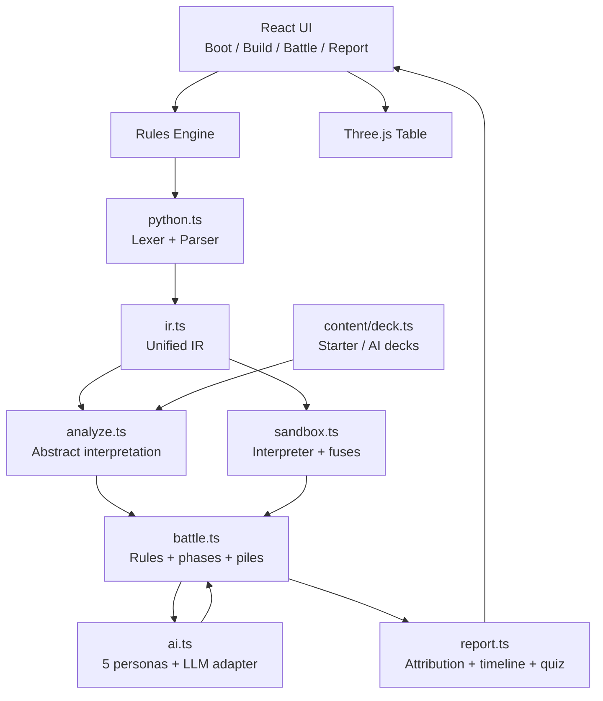

<a id="top"></a>

<div align="center">


# CODE THE BATTLE

***A turn-based card game that turns writing code back into combat.***

*“Vibe-coded too long and forgot how to code? Play Code the Battle and prove your code beats the AI in a turn-based card duel.”*

**Write cards, write tactics, build your deck with your own code, and try to beat an LLM-driven AI opponent in a turn-based card game.**

[](https://warpshlczy.github.io/Code-the-Battle/)
[](https://github.com/Warpshlczy/Code-the-Battle/actions/workflows/deploy.yml)
[](https://react.dev/)
[](https://www.typescriptlang.org/)
[](https://vite.dev/)
[](https://threejs.org/)
[](https://vitest.dev/)

**[简体中文](README.zh.md) · English**

</div>

---

## Contents

- [01 · What is this](#what)
- [02 · Why Code the Battle](#why)
- [03 · Feature map](#features)
- [04 · Play online](#live)
- [05 · Run locally](#start)
- [06 · Five-minute start](#quickstart)
- [07 · Rules](#rules)
- [08 · Card guide](#cards)
- [09 · Turn scripts](#scripts)
- [10 · API reference](#api)
- [11 · Two budgets](#economy)
- [12 · AI opponent](#ai)
- [13 · Post-battle review](#report)
- [14 · Language](#i18n)
- [15 · Architecture](#architecture)
- [16 · Project layout](#structure)
- [17 · Development and tests](#dev)
- [18 · FAQ](#faq)
- [19 · Quick start](#english)

---

<a id="what"></a>
## 01 · What is this

**Code the Battle** is a single-player, turn-based card game that runs entirely in the browser.

During deck building you write **5–10 cards**. During the duel you write a **short tactical script every turn**. The rules engine statically analyzes your code, runs it in a sandbox, resolves combat, and records every event. After the battle, the review screen shows which line did what.

Across the table sits an AI-driven humanoid dominator. It follows the same cost caps, Energy, pile and credit rules, with its own deck. It cannot see your code, your hand, or your draw order, and it does not announce its next move.

The AI is only the opponent. The cards and the tactics are written by you.

The game has two layers: build 5–10 cards, then write one script per turn. Everything else supports those two layers.

Both sides start at 100 HP and get 5 Energy per turn. Turn scripts share 14 credits per turn. Card effects are paid with Energy, not credits.

---

<a id="why"></a>
## 02 · Why Code the Battle

### 2.1 The moment most of us know

Using AI to write code is fine.

But if you cannot read or write the code yourself, how can you ask AI to do it for you?

Many people may never go back to hand-writing code, but staying in practice still matters.

That is where this game came from.

A few design choices:

| Normal card game | Code the Battle |
| --- | --- |
| Press a button, the card resolves | The card effect is an `effect(self, ctx)` you wrote |
| Tactics come from speed and luck | Tactics come from hand order, resources and scripts |
| Designers balance the numbers | Cost caps and effect budgets decide card strength |
| Losing shows a result screen | Losing shows line-by-line attribution |
| AI plays your cards or builds your deck | AI is only the opponent; it cannot read your code |
| Review is a chart | Review is a code interrogation with evidence |

### 2.2 Hard rules

1. **The code really runs.** Your `deal_damage` goes through IR, abstract interpretation, the sandbox and the battle engine, then lands in the event log. Animations are presentation; the result is not pre-scripted.
2. **The AI cannot see your cards.** It gets the public board and its own hand. Card names, descriptions, your hand, your draw order and your code never enter the prompt.
3. **The review can trace every line.** Each API call records its source, line number, credits, damage, block, healing and pile operations. After the battle you can see which line caused what.

### 2.3 Who it is for

- Developers who want the feel of hand-written logic again.
- Players who like Slay the Spire, Hearthstone or Magic, but want a deeper layer of programmatic expression.
- People learning to code who want variables, loops, conditions and functions in a scene with immediate feedback.
- Anyone surrounded by AI-generated code who wants to confirm they can still build a working system from scratch.
- People who like cyber visuals, holographic tables, terminals and glitch aesthetics.

---

<a id="features"></a>
## 03 · Feature map

### 3.1 Build phase

- **Hand-written card classes.** Fixed `name / cost / type / target` fields; only `effect(self, ctx)` is open.
- **Live static analysis.** Lines, complexity, variables, API calls, pile operations, effect cap `P`, credits and diagnostics.
- **Cost caps.** The printed cost sets the effect cap. Going over it fails compilation.
- **Registers.** Up to 3, typed `int / bool / enum`, with declared ranges.
- **Seed and opponent style.** The same seed reproduces the same battle. Only the combat style is revealed before the fight.
- **Card painter.** A 512×360 canvas with brush size, palette, custom colors, eraser, undo, redo and clear.
- **Card preview.** Art appears in the DOM card face, tooltip, discard preview and 3D hand.
- **Deck validation.** 5–10 cards; total cost, per-card caps and diagnostics.
- **Optional external tactics.** Point at a `chat/completions` endpoint with a model and key. The key stays in page memory.

### 3.2 Battle phase

- **Bottom terminal.** Write a script, confirm the command, return to the table, execute it. You can run several chunks in one turn.
- **Leftmost play.** `ctx.playcard()` always plays the leftmost card. Hand order is the tactic.
- **Hand scheduling.** `swap` and `move_card` reorder the hand; `pile_costs` reads costs.
- **Energy interrupt.** If Energy runs out, the command stops and a dialog shows which card needed what.
- **Three.js table.** Both sides show draw pile, hand and discard, with trays, glowing edges and counts.
- **Play animation.** Cards fly to the display zone, flip, highlight, then drop into discard. The remaining hand slides into place.
- **Block feedback.** A large 48px counter pops when block is gained and shatters when it breaks.
- **Presentation controls.** Slow, ×2, ×3 and skip. `prefers-reduced-motion` jumps to the final state.
- **Deck viewer.** Inspect both decks; the enemy deck lives in the opponent file.

### 3.3 Review phase

- **Code ledger.** Source, line, API, credits, damage, block, healing and pile operations.
- **Pile replay.** Draw, discard, shuffle, register writes, halts and AI actions on a timeline.
- **Code interrogation.** Multiple-choice questions generated from this battle's log, with evidence and explanations when you answer wrong.
- **Opponent file.** Persona, deck source and validation note, proposal count, fallback count, sample actions and audit records.
- **Replay check.** Rebuild public state from events and compare hashes and resources.
- **JSON export.** Seed, outcome, turns, deck weight, AI audit and every event.

### 3.4 Presentation

- Animated title screen with scanlines, vignette, a holographic opponent portrait and floating card data.
- Procedural SVG art for the arena, player, enemy and attack/skill card illustrations.
- Runtime Canvas textures for the table, card backs, card faces and painted art.
- A responsive camera that pulls back in portrait while keeping the leftmost card readable.
- Incremental hand mesh reconciliation: only meshes that change are moved.
- Click-to-expand discard piles; Esc closes. Enemy discard can be inspected separately.
- A fixed language button in the top-right corner, visible on every screen and modal.

---

<a id="live"></a>
## 04 · Play online

**Live demo:** https://warpshlczy.github.io/Code-the-Battle/

- No login, no download, static hosting only.
- Use a current Chrome, Edge, Firefox or Safari.
- WebGL is required for the Three.js table. Without it, the UI shows a "3D scene unavailable" notice.
- Game state never leaves the browser. The language choice is stored in `localStorage`.
- An external LLM key stays in page memory and disappears on refresh.

First run:

1. Open **View combat rules** and read the 30-second briefing.
2. Enter the build screen with the default English deck. Do not edit anything yet.
3. In the battle terminal, press **Example**, confirm the command, then execute it.
4. Try **Hand sort** once and watch what `pile_costs + swap + playcard` changes.
5. After the battle, open the code ledger and the code interrogation.

---

<a id="start"></a>
## 05 · Run locally

### 5.1 Requirements

- Node.js 20+ (22 LTS recommended)
- npm 10+
- A modern browser with WebGL 2, Canvas 2D and ES2022

### 5.2 Install and run

```bash
git clone https://github.com/Warpshlczy/Code-the-Battle.git
cd Code-the-Battle
npm install
npm run dev
```

Open the URL printed by Vite. The dev server binds to `127.0.0.1` by default. To expose it:

```bash
npm run dev -- --host 0.0.0.0 --port 5173
```

### 5.3 Build and preview

```bash
npm run build     # tsc -b && vite build
npm run preview   # preview dist/
```

`vite.config.ts` uses `base: './'`, so the build works under any sub-path, including a GitHub Pages project site.

### 5.4 Tests

```bash
npm test          # vitest run
npm run test:watch
```

The suite covers rules, credits, AI, presentation, balance, replay and smoke flows. There are 8 test files and 67 tests.

### 5.5 Scripts

| Command | Purpose |
| --- | --- |
| `npm run dev` | Start the Vite dev server |
| `npm run build` | TypeScript build + Vite production build into `dist/` |
| `npm run preview` | Preview the production build locally |
| `npm test` | Run Vitest once |
| `npm run test:watch` | Run Vitest in watch mode |

### 5.6 Deploy

Pushing to `main` runs `.github/workflows/deploy.yml`: install dependencies, run tests, build `dist/`, then publish to GitHub Pages. The live site is https://warpshlczy.github.io/Code-the-Battle/ . You can also trigger `workflow_dispatch` from the Actions page.

---

<a id="quickstart"></a>
## 06 · Five-minute start

### Step 1: title screen

- The **EN / 中文** button in the top-right corner switches language at any time. English is the default.
- Press **ENTER THE BUILD**.
- Press **View combat rules** for the briefing.

### Step 2: build

1. The left side is the card editor. The default deck already has 5–10 sample cards.
2. The right side edits registers, seed, opponent style and external tactics.
3. Every card shows effect cap `P`, credits, diagnostics and cost.
4. Open the **Card face** panel to paint your own art.
5. Once every card compiles, the deck has 5–10 cards and the registers are valid, you can start.

### Step 3: battle

1. The bottom terminal starts on the **Commands** tab.
2. Write a script, or load **Example / Hand sort / Previous turn**.
3. Press **Confirm command**. The engine locks the worst-case cost.
4. Return to the table and press **Execute terminal command**.
5. Run more chunks if you want. Press **Skip turn** to end your turn.
6. If Energy runs out, the command stops and the dialog explains which card needed how much.

> **The difference that matters:** Confirm compiles and locks; Execute actually runs the script.

### Step 4: review

The review screen opens after the battle:

- **Code ledger:** line, API, credits, damage.
- **Pile replay:** hand, draw, discard, shuffle and register changes.
- **Code interrogation:** questions about this battle's behavior.
- **Opponent file:** persona, deck provenance and validation, proposals and fallbacks.
- **Replay check:** state hash after replaying events.

### Language

- English by default on first load.
- The `EN / 中文` button switches instantly without a refresh.
- Untouched sample cards and default registers are localized. Your own card source is never rewritten.
- Switching only changes presentation. It does not change results, event logs or replay signatures.

---

<a id="rules"></a>
## 07 · Rules

### 7.1 Opening

| Rule | Value |
| --- | --- |
| Player HP | 100 |
| Opponent HP | 100 |
| Energy per turn | 5 |
| Opening hand | 5 cards |
| Draw per turn | Draw up to 5 cards |
| Hand limit | 10 |
| Deck size | 5–10 cards |
| Turn limit | 30 |
| Player deck cost display | Sum of all card costs |
| Opponent deck | Its own deck, under the same cost, Energy and pile rules |

### 7.2 Turn flow

1. **Turn start**
   - Block left from your previous turn clears (logged, with a shield dissolve cue).
   - Energy resets to 5.
   - Draw to 5 cards; if the draw pile is empty, shuffle the discard pile back.
2. **Tactics**
   - Write a script in the terminal.
   - You can call play, pile, read, register and resource APIs.
   - All script calls share **14 credits**.
3. **Playing cards**
   - `ctx.playcard()` always plays the leftmost card.
   - It resolves only if you have enough Energy.
   - Card effects are paid with Energy and do **not** consume script credits again.
4. **Registers**
   - `set_global()` writes and validates immediately. There is no end-of-turn batch commit.
5. **Turn end**
   - All remaining hand cards go to the discard pile (logged, with a fly-to-discard animation).
6. **Opponent turn**
   - The opponent uses the same Energy, pile and credit rules.
   - It sees only the public board and its own hand. It also discards its whole hand at the end.
7. **Ending**
   - If either side reaches 0 HP, the battle ends immediately.
   - After 30 turns, the remaining HP ratio decides.

### 7.3 Damage, block and healing

- **Block has no cap**, but it **lasts one round**: it clears at the start of your own next turn.
- Damage hits Block first, then HP.
- Healing cannot exceed max HP.
- Self-damage `ctx.deal_damage("self", n)` counts as a negative effect and discounts part of the net effect.
- Card effects, scripts and AI all use the same resolution logic.

### 7.4 Deck

- **5–10 cards**, hard cap 10.
- No deck budget and no copy limit.
- Duplicate names are allowed; card faces are distinguished by uid, so duplicates do not share art.
- Deck order does not decide the opening hand; a fixed-seed RNG draws.
- The build screen shows total cost and every card's effect cap.

### 7.5 Hand and piles

- Each side has a **draw pile / hand / discard pile**.
- Your hand is visible. The opponent's hand is always card backs.
- Draw piles show card backs and counts. Discards are public.
- The leftmost card is the next card played; `swap` and `move_card` can change the order.
- At turn end the whole hand goes to discard. Nothing carries over.

### 7.6 Registers

- Up to **3**.
- Types: `int` / `bool` / `enum`.
- `int` requires `min / max`; the span cannot exceed 1000.
- `enum` supports 1–8 values.
- `set_global()` works only in turn scripts and applies immediately.
- `get_global()` works in both card effects and scripts.
- Registers do not persist across battles.

Default English registers:

```python
combo : int  = 0      # 0..20
guard : bool = false
mode  : enum = "idle" # idle / assault / hold
```

The default Chinese registers remain in the source for tests and the Chinese UI:

```python
combo : int  = 0      # 0..20
guard : bool = false
mode  : enum = "默认" # 默认 / 强攻 / 蛰伏
```

### 7.7 Win and loss

- Opponent at 0 HP → **Protocol breached** (victory).
- You at 0 HP → **Link severed** (defeat).
- After 30 turns, the remaining HP ratio decides.
- Quitting a battle does not create a review record.

### 7.8 Determinism

- Same deck + same registers + same scripts + same seed + recorded AI actions = replayable.
- The game uses a fixed-seed RNG. AI randomness uses the same RNG.
- External LLM proposals are recorded. Replays consume recorded actions and never call the model again.

### 7.9 Hard limits

| Limit | Card `effect` | Turn script |
| --- | --- | --- |
| Max lines | 20 | 20 |
| Max complexity | 80 | 60 |
| Helper functions | 3 | 3 |
| Per helper | 30 lines / 120 complexity | 30 lines / 120 complexity |
| Characters per line | 200 | 200 |
| Variables | 10 | 10 |
| List length | 8 | 8 |
| Nesting | 4 | 4 |
| Loop depth | 2 | 2 |
| Loop bound | 10 | 10 |
| Total iterations | 96 | 120 |
| List writes | 64 | 64 |
| Call depth | 3 | 3 |
| Execution timeout | — | 140ms |

The editor hard-stops when you cross a limit; pasting code does not bypass it. Loops with unprovable bounds, recursion, `eval`, file access, network access and reflection all fail compilation.

---

<a id="cards"></a>
## 08 · Card guide

### 8.1 Smallest card

```python
class DirectStrike(Card):
    name = "Direct Strike"
    cost = 1
    type = "attack"
    target = "enemy"

    def effect(self, ctx):
        ctx.deal_damage("enemy", 7)  // Deal 7 damage
```

This card:

- costs 1;
- has an effect cap of 2.4;
- deals 7 damage (paid with Energy, separate from script credits);
- uses the trailing `//` comment as its description;
- carries the player's chosen art onto the 3D table.

### 8.2 Fixed fields

| Field | Allowed value | Notes |
| --- | --- | --- |
| `name` | string | Shown on the card face and in logs |
| `cost` | integer | Sets effect cap `P` |
| `type` | `attack` / `skill` | Only these two |
| `target` | `enemy` / `self` / `none` | Only these three |
| `effect(self, ctx)` | function | The only open effect entry |

There is no status system, rarity, card generation/removal API, arbitrary code execution, file/network/reflection/`eval`, direct pile array access, cross-battle registers or custom resolution order.

### 8.3 Cost sets the effect cap

| Cost | Effect cap `P` |
| --- | --- |
| 0 | 1.5 |
| 1 | 2.4 |
| 2 | 3.2 |
| 3 | 4.2 |
| 4 | 5.5 |
| 5+ | 6.4 |

Rules:

- Over the cap fails compilation and points at the offending line.
- 0-cost cards cannot use `gain_energy()`.
- Negative effects discount part of the net effect:
  - `deal_damage("self", n)`;
  - `discard(n)`;
  - `lose_energy(n)`.
- There is no per-cast cap on damage, healing, block, draw or energy gain. Cost, effect budget and credits are the real limits.
- Expressions are priced too: more operators, variables and nesting means a higher build-time cost, so `((2+3)*5)` cannot hide strength.

### 8.4 Card descriptions

`//` comments inside `def effect` become the card description. Multiple lines are joined with ` · `:

```python
def effect(self, ctx):
    ctx.deal_damage("enemy", 7)  // Deal 7 damage
    ctx.gain_block(2)            // Gain 2 Block this turn
```

### 8.5 Card painter

The build-phase **Card face** panel gives you:

- a 512×360 canvas;
- brush sizes 1–12;
- 8 preset colors plus a custom color;
- eraser, undo, redo and clear;
- border, background and marks as the base look;
- art in the DOM preview, tooltip, discard preview and 3D hand.

Art lives only in the current build session. It is not sent to a backend and does not persist across battles.

### 8.6 Example: self-damage for more damage

```python
class OverloadSlash(Card):
    name = "Overload Slash"
    cost = 2
    type = "attack"
    target = "enemy"

    def effect(self, ctx):
        ctx.deal_damage("enemy", 8)  // Deal 8 damage
        ctx.deal_damage("self", 2)   // Take 2 self-damage; it discounts the effect
```

Self-damage is not free stats. It enters the negative-effect discount, lowers the net effect, and shows up in card stats and the effect cap.

### 8.7 Example: 0-cost card

```python
class GlimmerPulse(Card):
    name = "Glimmer Pulse"
    cost = 0
    type = "attack"
    target = "enemy"

    def effect(self, ctx):
        ctx.deal_damage("enemy", 2)  // 0 cost: effect cap is 1.5
```

A 0-cost card caps at 1.5. It cannot turn into a free engine through `gain_energy()`.

### 8.8 Common compile failures

| Symptom | Cause |
| --- | --- |
| Effect over the cost cap | Lower the numbers, split into several cards, or add a negative effect |
| 0-cost card uses `gain_energy` | Forbidden by the rules |
| Loop bound cannot be proven | Use a fixed `range()` or write the statements directly |
| Recursion / `eval` / file / network | Rejected by the sandbox allowlist |
| Line or complexity limit | The editor hard-stops; split helpers or simplify |
| `set_global` name is not a literal | Register names must be string constants |
| Register out of range | Check the declared range and the written value |

---

<a id="scripts"></a>
## 09 · Turn scripts

### 9.1 Scripts are not card classes

A turn script is plain statements. No `class`:

```python
ctx.playcard()
ctx.playcard()
ctx.playcard()
ctx.playcard()
ctx.set_global("combo", min(ctx.get_global("combo") + 1, 20))
```

### 9.2 Execution model

- Every turn shares **14 credits**.
- Card effects are paid with Energy and do not consume credits again.
- **Confirm command** estimates and locks the worst case.
- **Execute terminal command** actually runs the script.
- You can run several chunks; costs accumulate.
- Runtime fuses cover iterations, time, list writes and string length.
- An Energy interrupt keeps the actions already executed; fix the script and submit again.

### 9.3 Hand order is the tactic

`ctx.playcard()` always plays the leftmost card. So:

- want big damage first → reorder with `swap` / `move_card`;
- want block first → move the block card to the left;
- want draw first → schedule the draw card first;
- want to keep a card → do not put it on the left.

Example: one bubble-sort pass

```python
costs = ctx.pile_costs("hand")
for i in range(1, 4):
    if costs[i] > costs[i - 1]:
        ctx.swap("hand", i - 1, i)
ctx.playcard()
ctx.playcard()
ctx.playcard()
```

This script:

1. reads hand costs;
2. does one local sort pass, pushing more expensive cards left;
3. plays three cards, prioritizing high-cost cards.

### 9.4 Cards vs scripts

| Dimension | Card effect | Turn script |
| --- | --- | --- |
| Entry | `effect(self, ctx)` | plain statements |
| Paid with | Energy | Credits |
| Budget | Cost-based effect cap `P` | 14 credits per turn |
| Runs when | The card is played | You press Execute |
| Can `playcard` | No | Yes |
| Can `set_global` | No | Yes |
| Can read globals | Yes | Yes |
| Participates in replay | Yes | Yes |

### 9.5 A locked example

```python
ctx.deal_damage("enemy", 10 * ctx.getTurn())
```

This pushes the worst case very high. Abstract interpretation estimates the upper bound; if it exceeds 14 credits, Confirm fails.

Better approaches:

- use reads and scheduling to reduce uncertainty;
- resolve several fixed, smaller effects;
- store state in registers instead of re-reading a lot of data;
- compress repeated statements with loops, remembering that the body cost multiplies by the iteration bound.

### 9.6 Register script

```python
mode = ctx.get_global("mode")
if mode == "assault":
    ctx.playcard()
    ctx.playcard()
else:
    ctx.gain_block(3)
ctx.set_global("combo", min(ctx.get_global("combo") + 1, 20))
```

`set_global` applies immediately; later reads in the same script see the new value.

---

<a id="api"></a>
## 10 · API reference

### 10.0 Conventions

- All calls live on `ctx`.
- `scope`:
  - **both** = card effects and turn scripts;
  - **script** = turn scripts only.
- Prices below are **script credit prices**, not the build-time effect cap `P`.
- Actual credits also include expressions, loops, conditions and nesting, so the UI total can be higher than the base API price.
- Pile arguments are `"draw"`, `"hand"` or `"discard"`.
- Damage targets are `"enemy"` or `"self"`.

### 10.1 Play and scheduling

| Signature | Scope | Returns | Base credits | Notes |
| --- | --- | --- | --- | --- |
| `ctx.playcard()` | script | bool | 0.8 | Plays the leftmost card; spends Energy only, does not read hand contents |
| `ctx.swap(pile, i, j)` | both | none | 0.3 | Swaps two cards in one pile |
| `ctx.move_card(from, fi, to, ti)` | both | none | 0.5 | Moves a card from any pile to a position in another pile |

Example:

```python
ctx.swap("hand", 0, 1)
ctx.move_card("draw", 0, "hand", 0)
ctx.playcard()
```

### 10.2 Draw, discard and piles

| Signature | Scope | Returns | Credit formula | Notes |
| --- | --- | --- | --- | --- |
| `ctx.draw(n)` | both | int | `1.5 + 0.9n + 0.04n²` | Draw n; if the draw pile is empty, shuffle discard back |
| `ctx.discard(n)` | both | int | `1.2 + 0.7n` | Discard the leftmost n hand cards; negative effect |
| `ctx.shuffle()` | both | none | `2.5` | Shuffle the draw pile with this battle's seed |
| `ctx.reshuffle()` | both | int | `3` | Shuffle discard back into draw, stopping when full |
| `ctx.pile_costs(pile)` | both | intlist | `0.3 + 0.08n` | Read every card cost in a pile |
| `ctx.hand_size()` | both | int | `0.1 + 0.06n` | Read hand size |
| `ctx.draw_size()` | both | int | `0.1 + 0.06n` | Read draw pile size |
| `ctx.discard_size()` | both | int | `0.1 + 0.06n` | Read discard pile size |
| `ctx.getHand()` | both | cardlist | `0.4 + 0.12n` | Read-only hand snapshot |
| `ctx.getDraw()` | both | cardlist | `0.4 + 0.12n` | Read-only draw pile snapshot |
| `ctx.getDiscard()` | both | cardlist | `0.4 + 0.12n` | Read-only discard snapshot |

Notes:

- `getHand / getDraw / getDiscard` snapshots include name, cost, type and target.
- You cannot access `ctx.hand`, `ctx.draw_pile` or `ctx.discard_pile` internal arrays.
- `discard` is a negative effect and can discount part of the net effect.

### 10.3 Combat and resources

| Signature | Scope | Returns | Credit formula | Notes |
| --- | --- | --- | --- | --- |
| `ctx.deal_damage(target, a)` | both | int | `4 + 1.2a + 0.12a²` | Damage; block first, then HP |
| `ctx.gain_block(a)` | both | none | `5 + 1.5a + 0.25a²` | Gain block until your next turn start |
| `ctx.heal(a)` | both | none | `4 + 2a + 0.2a²` | Heal up to max HP |
| `ctx.gain_energy(a)` | both | none | `14 + 8a` | Gain Energy immediately; expensive and forbidden on 0-cost cards |
| `ctx.lose_energy(a)` | both | none | `1 + 0.8a` | Lose Energy, minimum 0; negative effect |
| `ctx.random_int(min, max)` | both | int | `2 + 0.4×span` | Fixed-seed random integer, replayable |
| `ctx.log(message)` | both | none | `0.2` | Write a battle log entry for line-level review |

`span = max - min`, and `min >= 0`.

### 10.4 Read-only queries

| Signature | Scope | Returns | Credit formula | Notes |
| --- | --- | --- | --- | --- |
| `ctx.getTurn()` | both | int | `0.1 + 0.03n` | Current turn |
| `ctx.getEnergy()` | both | int | `0.1 + 0.04n` | Current Energy |
| `ctx.getBlock()` | both | int | `0.1 + 0.02n` | Current Block |
| `ctx.getMaxEnergy()` | both | int | `0.1 + 0.04n` | Energy per turn |
| `ctx.getHandLimit()` | both | int | `0.1 + 0.06n` | Hand limit |
| `ctx.getDrawLimit()` | both | int | `0.1 + 0.06n` | Draw pile limit |
| `ctx.enemy.hp()` | both | int | `0.1 + 0.015×HP` | Opponent HP |
| `ctx.enemy.block()` | both | int | `0.1 + 0.02×Block` | Opponent Block |
| `ctx.get_global(name)` | both | str / int / bool | `0.15 + 0.05n` | Read a register |

### 10.5 Registers, random and logs

| Signature | Scope | Returns | Credits | Notes |
| --- | --- | --- | --- | --- |
| `ctx.set_global(name, value)` | script | none | `0.6` | Write a register; the name must be a string literal |
| `ctx.get_global(name)` | both | register type | `0.15 + 0.05n` | Read a register |
| `ctx.random_int(min, max)` | both | int | `2 + 0.4×span` | Fixed-seed random |
| `ctx.log(message)` | both | none | `0.2` | Player log entry |

### 10.6 Snapshot fields

| Expression | Scope | Returns | Notes |
| --- | --- | --- | --- |
| `ctx.turn.played_count` | both | int | Cards played this turn |
| `ctx.turn.discarded_count` | both | int | Cards discarded this turn |
| `card.name` | both | str | Snapshot card name |
| `card.cost` | both | int | Snapshot card cost |
| `card.type` | both | str | `attack` / `skill` |
| `card.target` | both | str | `enemy` / `self` / `none` |

`ctx.turn` fields use fixed read pricing; `card.*` exists only on elements returned by `getHand / getDraw / getDiscard`.

### 10.7 Discouraged patterns

```python
ctx.deal_damage("enemy", ctx.getTurn() * 10)
ctx.draw(8)
ctx.gain_energy(3)
```

These are legal, but expensive:

- abstract interpretation estimates the upper bound;
- quadratic terms punish large values;
- if the worst case exceeds 14 credits, Confirm fails;
- at runtime there is a 140ms timeout and an iteration cap.

---

<a id="economy"></a>
## 11 · Two budgets

Cards and scripts use separate budgets. Cards are limited by cost; scripts share 14 credits per turn.

### 11.1 Build phase: effect cap `P`

- Only the card's `effect` is measured.
- Cost sets the cap.
- The UI shows each API's effect value and the card's current `P`.
- Over the cap fails compilation.
- Negative effects discount the net effect.

### 11.2 Battle phase: credits

- Only turn scripts are measured.
- Each turn shares 14 credits.
- The UI shows script credits, runtime credits and every API formula.
- Card effects do not consume credits again; they spend Energy.
- Confirm locks the worst case; runtime checks it again.

### 11.3 Why separate

Limit cards only by cost and scripts can reorder forever, making hand order meaningless. Limit scripts only by credits and cards can be arbitrarily strong, making cost decorative. Mix both and players cannot tell why a card is strong or a script is expensive.

So cards measure "how strong is this card by itself", and scripts measure "how complex is this turn's scheduling". Keeping them apart gives deck building and operation two independent decision layers.

### 11.4 Price intuition

| Type | Price tendency | Why |
| --- | --- | --- |
| Damage / block / heal | Medium-high, quadratic | Larger numbers snowball |
| Energy gain | Very expensive | Energy amplifies the whole turn |
| Draw / discard | Medium, linear in cards | Card advantage changes turn quality |
| Scheduling | Cheap | Encourages hand-order play |
| Reads | Cheap | Information should not cost more than action |
| Logging | Very cheap | Encourages review |

---

<a id="ai"></a>
## 12 · AI opponent

### 12.1 Five personas

| Persona | Style | Behavior |
| --- | --- | --- |
| Aggressor | Rush / sustained pressure | Attacks repeatedly while safe, does not waste Energy on defense |
| Controller | Control / slow tempo | Builds Block first, then pressures you into spending resources on defense |
| Discarder | Discard / queue tuning | Discards the card blocking the left slot so attacks connect |
| Combo | Draw / multi-card turns | Refills hand and Energy, then plays several cards in a row |
| Bait | Counterpunch / resource patience | Defends at low HP, waits for you to empty Energy, then hits back |

### 12.2 What the AI sees

**Allowed:**

- public board: both HP, Block, pile counts, discards, turn number;
- its own hand;
- its own Energy and deck information;
- public results of player actions.

**Not allowed:**

- your card names or descriptions;
- your hand;
- your draw order;
- your code;
- hidden resources or future intent.

### 12.3 External LLM (optional)

- Switch to **External tactics** during deck building.
- Fill in a `chat/completions` endpoint, model and key. Host-only input works too: `api.deepseek.com` becomes `https://api.deepseek.com/chat/completions`.
- DeepSeek example: endpoint `https://api.deepseek.com`, model `deepseek-chat`, key `sk-…`. Choosing a DeepSeek endpoint also replaces the untouched default model with `deepseek-chat`.
- The key stays in page memory; it is not written to localStorage or a backend.
- Browser requests require the endpoint to allow CORS.
- After the handshake, SENTINEL designs its own 5–10 card deck through the external model.
- Every designed card must declare cost/type/target, expose only `effect(self, ctx)` and carry a trailing `//` comment. The comment becomes the card description on its face and in its deck.
- A designed deck must contain at least two attacks, stay inside the total cost cap and compile through the same compiler as player cards. Model output is normalized first: `#` comments become `//`, extra fields and docstrings are removed, missing card text is filled in, and an over-budget effect raises the card's cost instead of rejecting it. Illegal cards are dropped, then the deck is trimmed to the card-count and total-cost caps. If the deck still fails, one corrective round is sent; only after both rounds fail, or on timeout/HTTP errors, does it fall back to the fixed deck.
- The model only proposes actions and deck source. The rules engine validates and executes them.
- Deck provenance (fixed vs self-designed, model, prompt hash, tokens, validation note and raw output) is kept in the battle state and shown in the opponent file and exported log.
- Any invalid, timed-out, over-budget or unparsable **action plan** still falls back to the fixed tactics as a whole, with an audit entry. The parser accepts fenced or prose-wrapped JSON, near-JSON (single quotes, trailing commas, full-width punctuation, raw newlines inside strings), multiple embedded JSON objects, operation aliases and Chinese verbs, plain op sequences and `reasoning_content`, so a well-formed plan is not rejected over formatting.

### 12.4 Fairness

- The opponent follows the same cost, Energy, pile and credit rules, with its own deck.
- Its self-designed deck passes the same compiler, effect cap and comment check as yours.
- It does not announce intent.
- It cannot read your code, hand or draw order.
- Its card names and descriptions never enter the action prompt.
- Before the battle it reveals only its combat style, not its hand or plan.

---

<a id="report"></a>
## 13 · Post-battle review

The review screen opens up this battle's code.

### 13.1 Code ledger

Every line records:

- source: script / card / opponent / engine;
- source line number;
- API call count;
- total credits;
- damage / block / healing;
- pile operations.

It answers: "Which line produced that 8 damage this turn?"

### 13.2 Pile replay

By turn:

- draw;
- discard;
- shuffle;
- register writes;
- command halts;
- AI actions;
- phase changes.

### 13.3 Code interrogation

Questions come from this battle's log:

- Which turn was a card discarded?
- Which API consumed the most credits?
- Which line caused an Energy interrupt?
- What was the last value written to a register?

Wrong answers show evidence and an explanation.

### 13.4 Opponent file

- Persona and style;
- deck source (fixed or self-designed) and deck validation note;
- raw deck design output, when one was produced;
- proposal count;
- fallback count;
- last prompt hash;
- last validation result;
- sample actions.

### 13.5 Replay check

Replay events into public pile and resource state, then compare hashes, HP, turn and outcome.

It checks:

- that the event log is self-consistent;
- that the replayed state matches the record;
- that the deterministic signature is stable.

### 13.6 JSON export

The review screen exports JSON:

```json
{
  "seed": 4242,
  "outcome": "victory",
  "turns": 9,
  "playerDeck": 12,
  "aiAudit": {},
  "events": []
}
```

Useful for balance analysis, bug reproduction or a custom visualization.

---

<a id="i18n"></a>
## 14 · Language

**The game defaults to English. The `EN / 中文` button in the top-right corner switches at any time.**

- First load is English. The choice is written to `localStorage` and kept on the next visit.
- The title screen, build, battle, review, rules modal, API reference and card painter update immediately.
- Engine logs stay in Chinese internally; the rendering layer translates them. Switching language does not change battles, events, hashes or replay results.
- Untouched sample cards and default registers follow the switch. Your edited cards and registers stay as written.
- 3D table labels, floating numbers and textures switch too. UI strings live in `src/i18n/`.

---

<a id="architecture"></a>
## 15 · Architecture

### 15.1 Overview



### 15.2 Compilation pipeline

```text
Source (Python-like DSL)
  → lexer
  → indentation / parser
  → AST
  → unified IR
  → abstract interpretation (ranges, worst case, negatives, cost, effect cap)
  → hard-limit checks
  → sandbox IR interpreter
  → battle resolution
  → event log
  → review / replay
```

### 15.3 Key modules

| Module | Responsibility |
| --- | --- |
| `src/engine/config.ts` | Rule constants, API allowlist, effect caps, credit prices, code limits |
| `src/engine/python.ts` | Restricted Python lexer/indentation/parser (`//` and `#` comments) |
| `src/engine/ir.ts` | AST → unified IR |
| `src/engine/analyze.ts` | Abstract interpretation, worst case, negatives, effect caps, credits, limits |
| `src/engine/sandbox.ts` | IR interpreter, runtime fuses, credit counter |
| `src/engine/battle.ts` | Phases, piles, block, damage, turns, outcome, event log |
| `src/engine/ai.ts` | Five personas, external LLM proposals, audit, fallback |
| `src/engine/rng.ts` | Fixed-seed deterministic RNG |
| `src/engine/report.ts` | Attribution, timeline, quiz, replay check |
| `src/content/deck.ts` | Sample decks, AI decks, sample scripts, bilingual defaults |
| `src/table/scene.ts` | Three.js table, camera, hand diffing, presentation |
| `src/table/textures.ts` | Procedural card/table textures |
| `src/table/timeline.ts` | Presentation timeline and speed labels |
| `src/table/transition.ts` | Transitions and state interpolation |
| `src/i18n/index.tsx` | Language state, storage, subscription, `useT` |
| `src/i18n/messages.ts` | Engine message / card name / description translations |
| `src/ui/*` | Title, build, battle, review, API, painter, language toggle |

### 15.4 Dependency direction

```text
content → analyze → python / ir
battle  → analyze / sandbox / ai / rng
report  → battle / content
UI      → engine public API only
table   → presentation state, not rules
```

`ai.ts` does not import the battle runtime. The AI only proposes actions; battle validates them.

### 15.5 Sandbox

- Allowlisted APIs only.
- No arbitrary execution, files, network, reflection or `eval`.
- No direct access to pile arrays.
- Loop bounds must be provable.
- Runtime limits:
  - 220 total iterations per turn;
  - 32 iterations per loop;
  - 64 list writes;
  - list length 8;
  - string length 64;
  - value 9999;
  - 140ms execution.
- Crossing a limit stops the current step, not the whole page.

### 15.6 Determinism

- Fixed-seed RNG.
- Event logs store source, line, API, values and state.
- Replay consumes recorded events and never calls the LLM again.
- Same deck + same seed + same scripts + same AI actions → same result.

### 15.7 3D layer

- Three.js handles the table, card meshes, camera and animation.
- Card faces are Canvas textures and can use painted art.
- Hand reconciliation moves only changed meshes.
- Presentation is decoupled from rules; skipping animation never changes resolution.
- `prefers-reduced-motion` jumps to the final state.
- Portrait view pulls the camera back to keep both sides readable.

---

<a id="structure"></a>
## 16 · Project layout

```text
Code-the-Battle/
├─ src/
│  ├─ App.tsx                 # Screen routing, deck, language switch
│  ├─ main.tsx                # React entry
│  ├─ assets/                 # Procedural SVG (arena / characters / card art)
│  ├─ content/
│  │  └─ deck.ts              # Sample decks, AI decks, bilingual defaults
│  ├─ engine/
│  │  ├─ config.ts            # Rules, APIs, prices, hard limits
│  │  ├─ python.ts            # Lexer / parser
│  │  ├─ ir.ts                # Unified IR
│  │  ├─ analyze.ts           # Abstract interpretation / caps / credits / limits
│  │  ├─ sandbox.ts           # IR interpreter + fuses
│  │  ├─ battle.ts            # Battle rules and event log
│  │  ├─ ai.ts                # Personas / LLM proposals / audit
│  │  ├─ rng.ts               # Fixed-seed RNG
│  │  └─ report.ts            # Attribution / timeline / quiz / replay
│  ├─ i18n/
│  │  ├─ index.tsx            # Language state / useT / localStorage
│  │  └─ messages.ts          # Engine messages / card names
│  ├─ table/
│  │  ├─ scene.ts             # Three.js table
│  │  ├─ textures.ts          # Card and table textures
│  │  ├─ layout.ts            # Fan layout
│  │  ├─ timeline.ts          # Presentation timeline
│  │  └─ transition.ts        # Transitions
│  └─ ui/
│     ├─ BootScreen.tsx       # Title / rules modal
│     ├─ BuildScreen.tsx      # Build
│     ├─ BattleScreen.tsx     # Battle / terminal
│     ├─ ReportScreen.tsx     # Review
│     ├─ ApiReference.tsx     # API reference
│     ├─ CodeEditor.tsx       # Restricted editor
│     ├─ CardPaint.tsx        # Card painter
│     ├─ LanguageToggle.tsx   # Top-right language button
│     ├─ components.tsx       # Card / panel / event feed
│     ├─ visual.ts            # Presentation cues
│     └─ theme.css            # Visual system
├─ tests/
│  ├─ rules.test.ts
│  ├─ economy.test.ts
│  ├─ ai.test.ts
│  ├─ balance.test.ts
│  ├─ table.test.ts
│  ├─ transition.test.ts
│  ├─ visual.test.ts
│  └─ smoke.test.ts
├─ .github/workflows/deploy.yml
├─ index.html
├─ package.json
├─ vite.config.ts
├─ vitest.config.ts
└─ tsconfig.json
```

---

<a id="dev"></a>
## 17 · Development and tests

### 17.1 Read these first

| What you want to change | Start here |
| --- | --- |
| Rules / numbers / APIs | `src/engine/config.ts` |
| Card syntax | `src/engine/python.ts` |
| Effect caps / credits | `src/engine/analyze.ts` |
| Runtime behavior | `src/engine/sandbox.ts` |
| Turns and piles | `src/engine/battle.ts` |
| AI behavior | `src/engine/ai.ts` |
| Review | `src/engine/report.ts` |
| Default decks | `src/content/deck.ts` |
| UI strings | `src/i18n/messages.ts` and the UI components |
| 3D presentation | `src/table/scene.ts` |

### 17.2 Test coverage

| File | Coverage |
| --- | --- |
| `rules.test.ts` | Cost caps, types/targets, comments, hard stops, 0-cost, expression pricing, self-damage discount |
| `economy.test.ts` | Credit prices, budget locking, loop compression, read pricing |
| `ai.test.ts` | Five personas, feasibility, information isolation, energy constraints |
| `balance.test.ts` | Starter deck win rate, hand-sort benefit, pure API strategies |
| `smoke.test.ts` | Compile, full battle, review, replay, energy interrupt |
| `table.test.ts` | Hand layout, pile caps, camera, card art handoff |
| `transition.test.ts` | Play slide, draw append, fan geometry |
| `visual.test.ts` | Block cue, phase cue, discard cue, duplicate card faces |

Run:

```bash
npm test
npm run build
```

There are 8 test files and 67 tests. The build output is in `dist/`.

### 17.3 When changing rules

1. Change constants in `config.ts`.
2. Update the boundaries in `analyze.ts` and `sandbox.ts`.
3. Run `npm test` and focus on `rules`, `economy` and `balance`.
4. If you changed UI strings, check `messages.ts` has the matching translation.
5. If you changed UI structure, check that the top-right language button still does not cover header actions.
6. If you changed the 3D table, check `table.test.ts` and portrait layout.

### 17.4 Build output

- `dist/` is static files only.
- No backend, environment variables or database.
- `base: './'` supports any sub-path.
- The 3D table needs WebGL; the rest of the UI still works with 2D Canvas / DOM.

---

<a id="faq"></a>
## 18 · FAQ

### Q1: Do I need to know Python?

No. You need a small restricted subset: classes, assignment, `if`, `for range`, function calls and basic expressions. No `import`, files, network or `eval`.

### Q2: Does the card really execute my code?

Yes. Source goes through lexer/parser, IR, abstract interpretation and hard limits, then the sandbox interpreter. Animation is presentation; resolution is interpreted.

### Q3: Can the AI peek at my cards or code?

No. The AI receives only the public board and its own hand. Card names, descriptions, your hand, draw order and code never enter the prompt.

### Q4: Why does my card fail to compile?

Common causes:

- effect over the cost cap;
- 0-cost card uses `gain_energy`;
- loop bound cannot be proven;
- line or complexity limit;
- API not on the allowlist;
- register write out of range.

### Q5: Why does script confirmation fail?

The worst case exceeds 14 credits. Lower the numbers, read less, split large loops, or use cheaper scheduling APIs.

### Q6: Does switching language change the battle?

No. Language changes presentation only. Engine logs, events, hashes and replay results stay stable.

### Q7: Does switching language translate my cards?

No. Only untouched sample cards and default registers switch. Custom card source stays as written.

### Q8: Is card art saved?

Only for the current build session. Refreshing loses it; there is no cloud save.

### Q9: Is the external LLM key safe?

The key stays in page memory and disappears on refresh. There is no backend. The browser calls the endpoint directly, so it must allow CORS.

### Q10: Can I play on a phone?

Yes. The UI is responsive and the 3D camera pulls back in portrait. Writing code and reading piles are still more comfortable on a desktop.

### Q11: Why is English the default?

It lets players who do not read Chinese try the game immediately. The top-right button switches to Chinese, and the choice is stored in the browser.

### Q12: Can I use it for teaching, streaming or remixing?

Yes, for learning, teaching demos and content creation. Contact the repository owner before redistributing.

---

<a id="english"></a>
## 19 · Quick start

Chinese edition: [README.zh.md](README.zh.md).

**Code the Battle** is a browser-only, turn-based card game where you write the cards and the tactics yourself.

- Build 5–10 cards in a small Python-like DSL.
- Each card has fixed fields and one open `effect(self, ctx)`.
- Each turn, write a short script in the terminal.
- The engine statically analyzes and sandbox-executes every line, then logs the result.
- The AI sees only the public board and its own hand.

**Live:** https://warpshlczy.github.io/Code-the-Battle/

Default language is **English**. The `EN / 中文` button switches at any time. Custom cards are never machine-translated.

```python
class DirectStrike(Card):
    name = "Direct Strike"
    cost = 1
    type = "attack"
    target = "enemy"

    def effect(self, ctx):
        ctx.deal_damage("enemy", 7)  // Deal 7 damage
```

```bash
npm install
npm run dev
npm test
npm run build
```

---

Issues and rule suggestions are welcome. Run `npm test` and `npm run build` before opening a PR.
